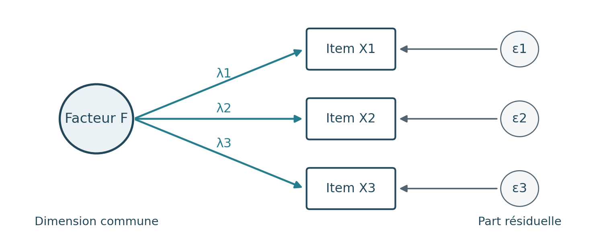

# Mesurer une dimension que l’on n’observe pas directement {#sec-mesurer}

```{r}
#| include: false
source("_common.R")
```

::: {.callout-note title="Objectifs du chapitre"}
- Distinguer un indicateur, un score calculé, un facteur et un score factoriel.
- Écrire l’équation d’un indicateur continu et décomposer sa variance.
- Comprendre pourquoi un facteur doit recevoir une échelle par convention.
- Compter les degrés de liberté d’un modèle et savoir ce que ce compte ne garantit pas.
:::

::: {.callout-tip title="Idée centrale"}
Une AFC traduit une hypothèse de mesure en une structure de covariances. Le modèle dit d’où viennent les relations entre les réponses : d’un facteur commun, d’un lien entre facteurs ou d’un lien résiduel. L’analyse examine si les données sont compatibles avec cette explication.
:::

## D’une question substantielle à un modèle

Supposons que nous voulions mesurer l’engagement dans une formation. Nous pouvons observer des réponses à des questions sur l’intérêt, l’effort et la persévérance. Nous ne voyons pas directement une quantité appelée « engagement ». Nous proposons qu’une dimension commune contribue aux réponses. Cette dimension est une **variable latente**, ou un **facteur**; les réponses sont ses **indicateurs**.

L’AFC commence par une organisation explicite des indicateurs. Dire que trois items mesurent l’intérêt et que trois autres mesurent l’effort constitue une hypothèse différente de celle d’un facteur unique. Ces hypothèses impliquent des structures différentes de covariances. L’analyse cherche dans quelle mesure les données sont compatibles avec la structure annoncée.

Le mot *confirmatoire* ne signifie pas que le logiciel confirme automatiquement la théorie. Il signifie que la structure à examiner est spécifiée avant l’estimation. Une structure choisie après de nombreuses modifications sur les mêmes données conserve une dimension exploratoire, même si elle est estimée par une AFC [@bollen1989; @brown2015].

## Indicateur et facteur ne sont pas interchangeables

Un indicateur possède une colonne dans le fichier. Un facteur est défini par un ensemble de relations avec des indicateurs. Une moyenne d’items est un score observé calculé; ce n’est pas le facteur latent lui-même. Un score factoriel est une estimation individuelle dérivée du modèle; il n’est pas non plus une observation directe du facteur.

| Objet | Exemple | Statut |
|---|---|---|
| Indicateur | Réponse à l’item « je poursuis malgré les difficultés » | Valeur observée |
| Score de somme ou de moyenne | Moyenne de quatre réponses | Calcul sur les réponses |
| Facteur | Persévérance commune aux indicateurs | Variable latente du modèle |
| Score factoriel | Estimation de la persévérance d’une personne | Prédiction dépendant du modèle |

Cette distinction compte pour l’interprétation des corrélations et de la fiabilité. Une corrélation entre deux moyennes d’items et une corrélation entre deux facteurs ne répondent pas exactement à la même question.

## L’équation d’un indicateur continu

Dans un modèle simple, l’indicateur $X_i$ s’écrit :

$$X_i = \nu_i + \lambda_i F + \varepsilon_i.$$

$\nu_i$ est l’intercept, $\lambda_i$ la **saturation** et $\varepsilon_i$ le **résidu**. La saturation indique comment la valeur attendue de l’indicateur varie avec le facteur. Le résidu représente la partie de l’indicateur que le facteur n’explique pas. Il peut comprendre de l’erreur de mesure, des spécificités du contenu ou d’autres influences non représentées.

On ne doit donc pas lire « résidu » comme synonyme d’« erreur de saisie ». Une variance résiduelle importante peut révéler que l’indicateur possède une composante spécifique substantielle.

{width=80% #fig-mesure}

Dans une structure simple, avec un facteur non corrélé aux résidus, la variance de l’indicateur se décompose ainsi :

$$\operatorname{Var}(X_i)=\lambda_i^2\operatorname{Var}(F)+\theta_{ii}.$$

Lorsque l’indicateur et le facteur sont standardisés et que l’indicateur ne mesure qu’un facteur, une saturation de $0{,}70$ correspond à une proportion expliquée de $0{,}70^2=0{,}49$. Environ 49 % de la variance de cet indicateur est alors attribuée à ce facteur dans le modèle. Ce raisonnement ne doit pas être transposé sans précaution à une structure complexe ou à la somme des catégories d’un item ordinal.

## Ce que le modèle explique entre les variables

Deux indicateurs associés au même facteur partagent de la variance. Avec des résidus non corrélés :

$$\operatorname{Cov}(X_i,X_j)=\lambda_i\lambda_j\operatorname{Var}(F).$$

Si deux indicateurs dépendent de facteurs différents, leur covariance dépend aussi du lien entre ces facteurs : $\operatorname{Cov}(X_i,X_j)=\lambda_i\lambda_j\operatorname{Cov}(F_1,F_2)$. Une **covariance résiduelle** ajoute une source de relation qui n’est pas expliquée par les facteurs. Elle peut se justifier, par exemple, par un libellé commun ou une méthode de mesure partagée. Elle ne doit pas servir à absorber sans explication tous les écarts entre le modèle et les données.

L’écriture d’ensemble est $\Sigma=\Lambda\Phi\Lambda^{\mathsf T}+\Theta$. Cette équation signifie simplement : la covariance prédite entre les indicateurs combine la partie portée par les facteurs et la partie résiduelle. Vous n’avez pas à saisir cette équation dans l’application.

```{r}
#| label: fig-reproduction
#| fig-cap: "Avec des saturations standardisées de 0,80, 0,70 et 0,60 sur un même facteur, la corrélation prédite entre deux indicateurs est le produit de leurs saturations. Le modèle n’a pas de paramètre propre à chaque paire : il « explique » les trois corrélations avec trois saturations."
#| fig-width: 6.5
#| fig-height: 3.2
l <- c(X1 = .8, X2 = .7, X3 = .6)
paires <- data.frame(paire = c("X1–X2", "X1–X3", "X2–X3"),
                     r = c(l[1] * l[2], l[1] * l[3], l[2] * l[3]))
paires$lab <- paste0(c("0,80 × 0,70", "0,80 × 0,60", "0,70 × 0,60"), " = ", v(paires$r, 2))
ggplot(paires, aes(paire, r)) +
  geom_col(fill = PAL["bleu"], width = .55) +
  geom_text(aes(label = lab), vjust = -.5, size = 3.6) +
  scale_y_continuous(limits = c(0, .7), labels = function(x) v(x, 1)) +
  labs(x = NULL, y = "Corrélation prédite") + theme_manuel()
```

## Donner une échelle au facteur

Le facteur n’a pas d’unité naturelle directement observée. L’application propose deux conventions d’identification : **λ₁=1**, qui fixe à 1 la saturation d’un indicateur de référence, et **σ²(F)=1**, qui fixe la variance du facteur à 1. Une convention est indispensable; elle ne constitue pas une découverte empirique.

Avec l’indicateur de référence, le facteur est exprimé dans une unité liée à cet indicateur. La saturation fixée à 1 n’est ni une corrélation parfaite ni la preuve que cet indicateur est le meilleur. Elle n’est pas estimée librement et son absence de test de significativité est normale.

Changer correctement de convention peut modifier les coefficients non standardisés et les variances factorielles sans modifier les covariances reproduites ni l’ajustement global. L’interprétation des coefficients standardisés aide à comparer les résultats obtenus sous ces conventions. Le chapitre suivant le vérifie sur des données réelles : entre les deux conventions, les saturations standardisées du modèle de référence diffèrent au plus de `r format(signif(REF$hs_stdlv$ecart_max, 1), scientific = FALSE, decimal.mark = ",")`.

Le **sens** du facteur dépend aussi de son orientation. Si l’on renverse simultanément le signe des relations d’un facteur, on peut obtenir une représentation équivalente. Une saturation négative doit donc être examinée en tenant compte du contenu et du codage de l’item, ainsi que de l’orientation des autres indicateurs.

## Identification et degrés de liberté

Un modèle est identifiable lorsque les paramètres visés peuvent être déterminés à partir des informations disponibles, sous les contraintes posées. Avoir un nombre positif de degrés de liberté est une condition de comptage utile, mais ne prouve pas à elle seule l’identification.

Pour $p$ indicateurs continus, il existe $p(p+1)/2$ variances et covariances distinctes. Avec neuf indicateurs, on en compte $9\times10/2=45$. Le modèle usuel à trois facteurs et trois indicateurs par facteur comporte `r REF$hs$npar` paramètres de covariance libres : six saturations, neuf variances résiduelles, trois variances factorielles et trois covariances factorielles. On obtient donc $45-`r REF$hs$npar`=`r 45 - REF$hs$npar`$ degrés de liberté, sous l’identification par indicateur de référence et sans covariance résiduelle ajoutée. L’application affiche ce même nombre de paramètres libres dans le bandeau qui suit l’estimation.

| Modèle | Moments distincts | Paramètres libres | Degrés de liberté |
|---|---:|---:|---:|
| 1 facteur, 3 indicateurs | 6 | 6 | 0 |
| 1 facteur, 4 indicateurs | 10 | 8 | 2 |
| 3 facteurs, 3 indicateurs chacun | 45 | `r REF$hs$npar` | `r 45 - REF$hs$npar` |
| 1 facteur, 9 indicateurs | 45 | 18 | 27 |

Un facteur mesuré par trois indicateurs continus, avec les contraintes usuelles et sans autre restriction, possède zéro degré de liberté. Il peut reproduire exactement les covariances sans soumettre cette structure à un test global informatif. Un ajustement parfait dans ce cas ne constitue pas une validation.

Deux indicateurs par facteur ne donnent pas automatiquement un modèle identifiable. L’application peut permettre la saisie, mais l’identification dépend de l’ensemble du modèle et des restrictions. Pour les premières activités, utilisez les structures fournies.

::: {.callout-note title="Dans l’application"}
L’onglet **Introduction** de la configuration rappelle ces notions dans **Concepts de base**, **Équations** et **Séquence d’analyse**. Il ne lance aucun calcul. Le bandeau qui apparaît après chaque estimation indique l’effectif utilisé et le nombre de paramètres libres : comparez-le à votre propre compte.
:::

## Laboratoire : compter avant d’estimer

Sans ouvrir l’application, complétez le compte pour deux modèles construits sur les six premiers tests de Holzinger–Swineford.

1. Un facteur unique mesuré par `x1` à `x6`, identification **λ₁=1**.
2. Deux facteurs corrélés, `x1`–`x3` et `x4`–`x6`, même identification.

Pour chacun, calculez les moments distincts, les paramètres libres et les degrés de liberté. Dites ensuite lequel des deux modèles impose le plus de restrictions aux données.

::: {.callout-tip title="Réponse" collapse="true"}
Six indicateurs donnent $6\times7/2=21$ moments distincts.

1. Un facteur : cinq saturations libres, six variances résiduelles et une variance factorielle, soit 12 paramètres et $21-12=9$ degrés de liberté.
2. Deux facteurs : quatre saturations libres, six variances résiduelles, deux variances factorielles et une covariance, soit 13 paramètres et 8 degrés de liberté.

Le modèle à un facteur impose une restriction de plus : il revient à fixer à 1 la corrélation entre les deux facteurs du second modèle. Ce cas limite explique pourquoi le chapitre sur l’ajustement déconseille de comparer ces deux modèles par une simple différence de chi carré.
:::

::: {.callout-important title="À retenir"}
- Un facteur est défini par ses relations avec des indicateurs; une moyenne d’items et un score factoriel n’en sont que des approximations.
- La saturation standardisée au carré donne la part de variance d’un indicateur attribuée à son facteur, dans une structure simple.
- La convention d’échelle (λ₁=1 ou σ²(F)=1) change les coefficients non standardisés, pas l’ajustement.
- Des degrés de liberté positifs sont nécessaires pour tester une structure, mais ne garantissent pas l’identification.
:::

## Quiz

1. Pourquoi une saturation fixée à 1 ne prouve-t-elle pas une mesure parfaite ?
2. Une variance résiduelle importante désigne-t-elle nécessairement une erreur accidentelle ?
3. Pourquoi une moyenne d’items n’est-elle pas une variable latente ?
4. Un modèle à un facteur et trois indicateurs s’ajuste parfaitement. Qu’en conclure ?

::: {.callout-tip title="Réponses" collapse="true"}
1. La valeur 1 est une convention d’échelle : elle n’est pas estimée et ne mesure pas la qualité de l’indicateur.
2. Non. Le résidu peut contenir une spécificité réelle du contenu ou de la méthode.
3. La moyenne est calculée directement sur les réponses; elle ne sépare pas la partie commune de la partie résiduelle.
4. Rien sur la structure : le modèle a zéro degré de liberté et reproduit exactement les covariances par construction.
:::
