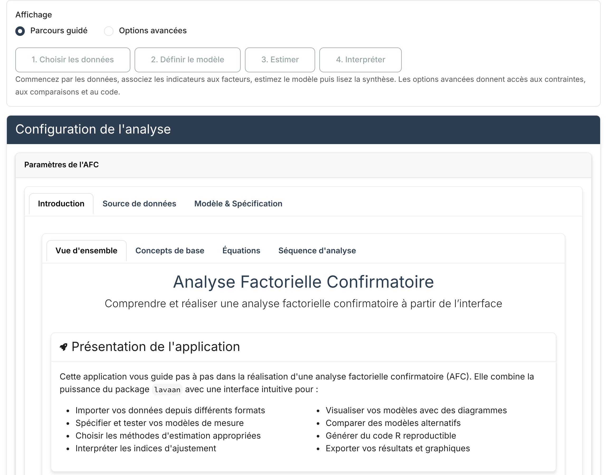
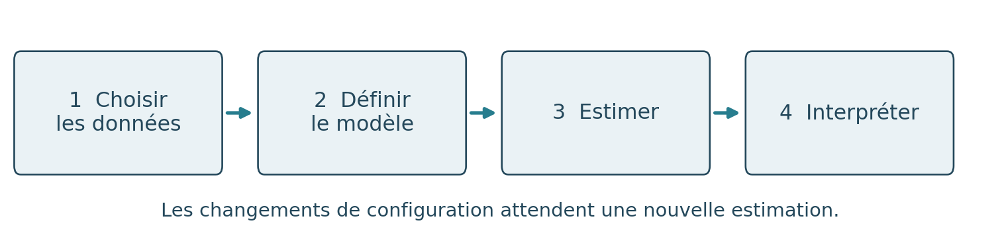
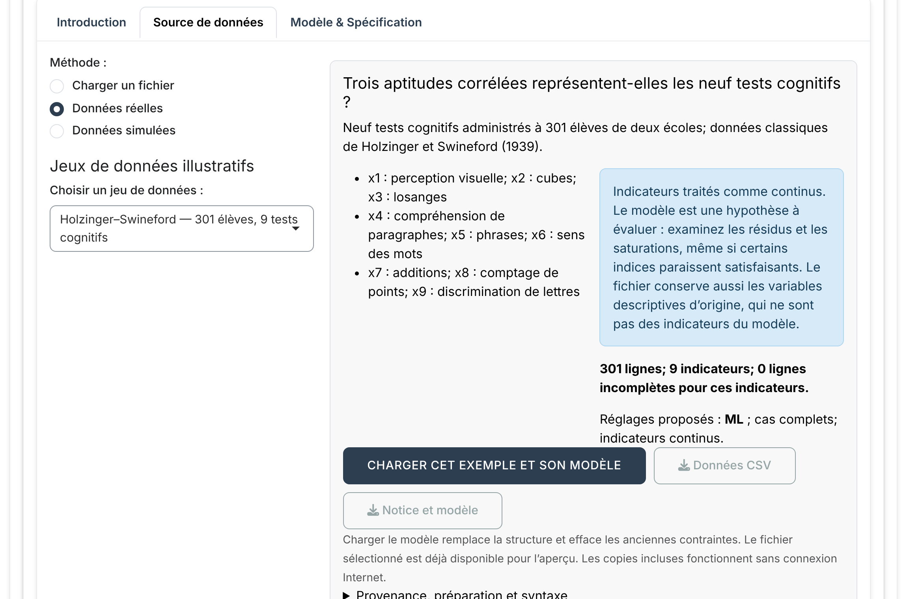
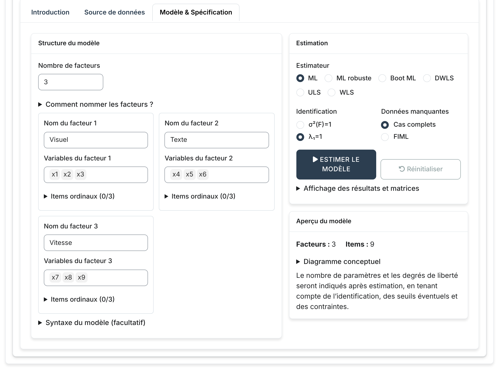

# Se repérer dans l’application {#sec-interface}

```{r}
#| include: false
source("_common.R")
```

::: {.callout-note title="Objectifs du chapitre"}
- Reconnaître les quatre étapes du parcours et les deux modes d’affichage.
- Distinguer la sélection d’un fichier et la préparation d’un modèle.
- Savoir quelle analyse les résultats et les exports décrivent.
- Réinitialiser proprement une analyse sans perdre les données.
:::

::: {.callout-tip title="Idée centrale"}
L’application sépare la **configuration** (données, modèle, réglages) et l’**analyse enregistrée** (le résultat d’une estimation). Tant que vous n’avez pas estimé de nouveau, les résultats et les rapports décrivent l’analyse précédente, même si les contrôles affichent d’autres réglages.
:::

## Les quatre étapes

La barre supérieure propose **1. Choisir les données**, **2. Définir le modèle**, **3. Estimer** et **4. Interpréter**. Ces commandes constituent le parcours principal. Vous pouvez revenir aux données ou au modèle pour préparer une autre analyse, mais les résultats déjà calculés ne sont pas automatiquement remplacés.

{#fig-app-accueil width=100%}

{#fig-parcours width=100%}

| Commande | Ce que vous y faites |
|---|---|
| 1. Choisir les données | Importer un fichier, sélectionner un exemple réel ou préparer une simulation |
| 2. Définir le modèle | Nommer les facteurs, associer les indicateurs et vérifier les réglages |
| 3. Estimer | Calculer et enregistrer l’analyse correspondant à cette configuration |
| 4. Interpréter | Lire la synthèse, les indices et les signaux de l’analyse enregistrée |

Le bouton **4. Interpréter** devient utile après une estimation réussie. Il ouvre une vue dédiée; il ne lance pas une nouvelle estimation. **Revenir aux résultats** ramène aux tableaux et graphiques de la même analyse.

## Deux modes d’affichage

**Parcours guidé** présente les commandes courantes. **Options avancées** ajoute notamment les contraintes, les comparaisons et le code. Commencez en parcours guidé. Les activités avancées indiquent explicitement quand changer de mode.

Changer de mode ne supprime pas les restrictions déjà posées. Si des contraintes restent actives, l’application les signale. Masquer un panneau n’annule pas ses réglages. Pour repartir sans ancienne contrainte, utilisez **Réinitialiser**, puis rechargez le modèle de l’exemple.

| Élément | Parcours guidé | Options avancées |
|---|:---:|:---:|
| Données, modèle, estimation, interprétation | oui | oui |
| Statistiques descriptives, fiabilité, validité, scores, diagramme | oui | oui |
| Onglet **Contraintes** (covariances résiduelles, paramètres fixes) | non | oui |
| **Analyse → Comparaisons** (tests d’égalité) | non | oui |
| HTMT2 et intervalles bootstrap dans **4. Interpréter** | non | oui |
| Onglet **Code** (R et ébauche Stata) | non | oui |

## La source de données

Trois choix sont possibles. **Charger un fichier** accepte notamment CSV, SAV, DTA et Excel. **Données réelles** donne accès aux sept fichiers inclus. **Données simulées** prépare une population pédagogique et génère un échantillon à partir des réglages choisis.

Dans les données réelles, sélectionner un nom charge le fichier pour consultation. Le bouton **Charger cet exemple et son modèle** accomplit une action supplémentaire : il remplace la structure du modèle et prépare les réglages proposés. Ne confondez pas la sélection du fichier avec la préparation du modèle.

{#fig-app-source width=100%}

Lisez la fiche avant de continuer. Elle précise la question, les variables, leur codage, les lignes incomplètes et les limites de l’exemple. Pour les jeux ordinaux, le chargement du modèle préconfigure aussi les indicateurs ordinaux et WLSMV.

## La page Modèle et Spécification

La structure apparaît à gauche et l’estimation à droite sur une fenêtre suffisamment large. Chaque facteur possède un nom et une sélection d’indicateurs. Sur une fenêtre étroite, les blocs se placent l’un sous l’autre; aucune étape n’est supprimée.

{#fig-app-modele width=100%}

Les noms doivent commencer par une lettre, être uniques et ne pas reprendre le nom d’une colonne. Utilisez des lettres sans accent, des chiffres ou un trait de soulignement : `Visuel`, `AffectPositif` ou `Engagement_formation`. Le nom affiché est un identifiant; vous pouvez employer un libellé plus développé dans votre rapport.

Sous chaque facteur, **Items ordinaux** indique le nombre de variables sélectionnées comme ordinales. Dépliez ce contrôle pour vérifier ou modifier les cases. Une réponse binaire correcte/incorrecte est aussi traitée comme catégorielle ordonnée dans les exemples concernés.

Le **Diagramme conceptuel** montre la structure annoncée. Il ne représente pas encore des estimations. Les options détaillées et la syntaxe sont repliables pour garder les commandes principales accessibles. Aucun code n’est nécessaire pour les manipulations de ce manuel.

## Des résultats conservés après estimation

Après une estimation réussie, les résultats s’ouvrent sur **Données**. Les autres panneaux présentent les descriptives, l’analyse, le diagramme et l’aide. Le bandeau indique notamment l’effectif utilisé et les paramètres libres.

{#fig-app-resultats width=100%}

Si vous modifiez ensuite le modèle ou un réglage d’estimation, le bandeau devient orange et rappelle que les résultats et exports correspondent encore à l’analyse précédente. Ce comportement protège la cohérence des documents téléchargés. Pour appliquer les changements, cliquez de nouveau sur **3. Estimer**.

::: {.callout-warning title="Avant de recopier un résultat"}
Vérifiez le nom du fichier, les indicateurs, l’estimateur et l’effectif de l’analyse enregistrée. Un changement visible dans les contrôles n’est pas nécessairement un changement déjà appliqué aux résultats.
:::

## Réinitialiser sans perdre le fichier

**Réinitialiser** efface les anciennes contraintes, les covariances résiduelles ajoutées, les comparaisons et les résultats disponibles. Les données restent chargées. Vous devrez redéfinir ou recharger la structure à analyser. Ce bouton ne remplace pas le téléchargement préalable d’un rapport que vous souhaitez conserver.

Pour reprendre un exemple à son point de départ, la procédure la plus simple est : retourner à **Données réelles**, sélectionner le jeu et cliquer sur **Charger cet exemple et son modèle**. Relisez ensuite les réglages avant d’estimer.

## Laboratoire : préparer une analyse sans l’estimer

1. Ouvrez **1. Choisir les données**, puis **Données réelles**.
2. Sélectionnez Holzinger–Swineford et lisez la fiche.
3. Téléchargez la **Notice et modèle** et les **Données CSV**.
4. Cliquez sur **Charger cet exemple et son modèle**.
5. Vérifiez que trois facteurs apparaissent et que leurs noms sont `Visuel`, `Texte` et `Vitesse`.
6. Dépliez le **Diagramme conceptuel** et retrouvez les trois groupes d’indicateurs.

Questions : combien de lignes et d’indicateurs la fiche annonce-t-elle ? Quel estimateur est proposé ? Le diagramme affiche-t-il des coefficients ?

::: {.callout-tip title="Réponse" collapse="true"}
La fiche annonce `r ent(REF$hs$n)` lignes, 9 indicateurs et aucune ligne incomplète pour ces indicateurs. L’estimateur proposé est ML, avec les cas complets et des indicateurs continus. Le diagramme conceptuel n’affiche aucun coefficient : il représente la structure annoncée, pas une estimation. Vous avez préparé une analyse; vous n’avez encore ni estimé les paramètres ni évalué l’ajustement.
:::

::: {.callout-important title="À retenir"}
- Les quatre étapes vont des données à l’interprétation; seule **3. Estimer** produit une nouvelle analyse.
- **Charger cet exemple et son modèle** remplace la structure et les réglages; sélectionner un jeu ne fait que l’ouvrir.
- Un bandeau orange signale que les contrôles ne correspondent plus aux résultats affichés.
- **Réinitialiser** efface contraintes et résultats, pas les données.
:::

## Quiz

1. Vous changez l’estimateur après une estimation, puis téléchargez le rapport. Quelle analyse le rapport décrit-il ?
2. Le bouton **4. Interpréter** lance-t-il une estimation ?
3. Où se trouvent les tests d’égalité de saturations ?
4. Vous passez du mode avancé au mode guidé. Une covariance résiduelle ajoutée est-elle supprimée ?

::: {.callout-tip title="Réponses" collapse="true"}
1. L’analyse estimée précédemment : le changement d’estimateur ne s’applique qu’après **3. Estimer**.
2. Non. Il ouvre la synthèse de l’analyse enregistrée.
3. Dans **Analyse → Comparaisons**, visible en **Options avancées**.
4. Non. Masquer un panneau n’annule pas ses réglages; l’application signale les contraintes encore actives.
:::
