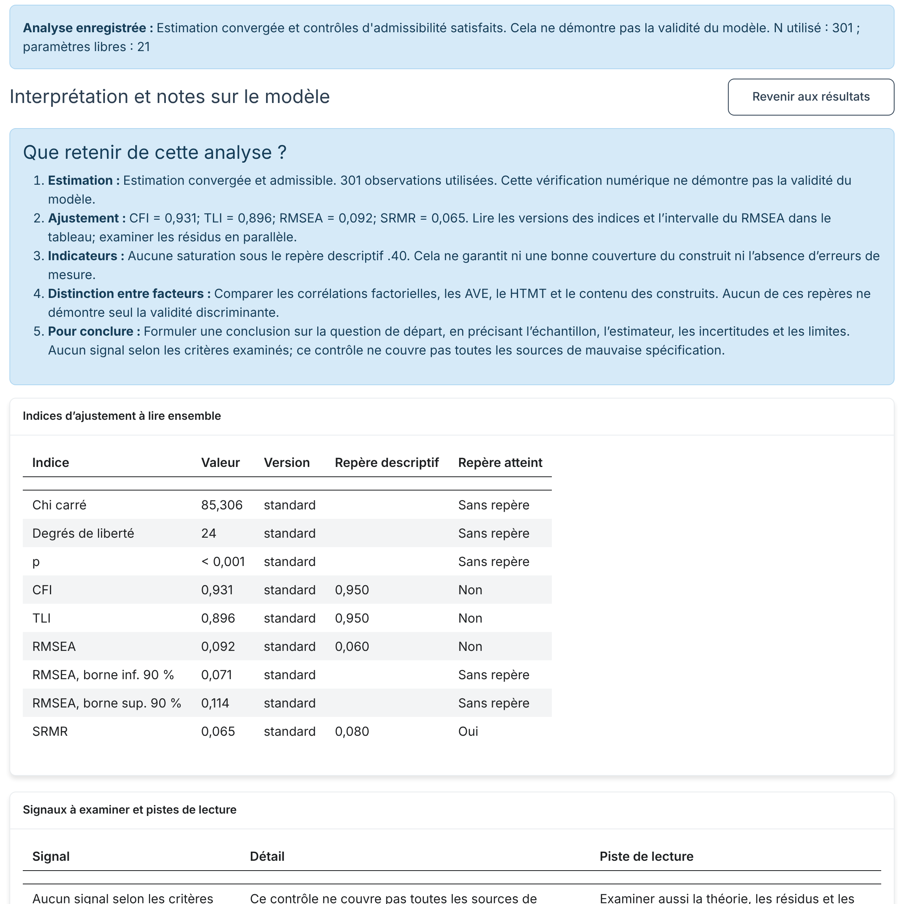

# Évaluer l’ajustement sans se laisser gouverner par un seuil {#sec-ajustement}

```{r}
#| include: false
source("_common.R")
U <- REF$hs_un$fit
M <- REF$hs_mlr
```

::: {.callout-note title="Objectifs du chapitre"}
- Distinguer convergence, admissibilité et ajustement.
- Lire le chi carré, le CFI, le TLI, le RMSEA avec son intervalle et le SRMR.
- Reconnaître les versions standard, *scaled* et *robust* d’un indice.
- Comparer des modèles concurrents sans réduire la décision à un seuil.
:::

::: {.callout-tip title="Idée centrale"}
Chaque indice d’ajustement répond à une question un peu différente : écart exact, amélioration relative, écart approximatif par degré de liberté, écart moyen standardisé. On les lit ensemble, avec leurs versions, puis on cherche **où** le modèle s’écarte des données.
:::

## Trois questions différentes

Avant de lire un indice d’ajustement, distinguez trois niveaux. **La convergence** indique que l’algorithme a trouvé une solution selon son critère numérique. **L’admissibilité** concerne notamment l’absence de certaines impossibilités, telles qu’une variance résiduelle négative. **L’ajustement** concerne la reproduction des relations observées par le modèle.

Une solution convergée peut être inadmissible. Une solution convergée et admissible peut être mal ajustée. Enfin, un modèle bien ajusté ne prouve pas à lui seul que les construits portent le sens théorique que nous leur attribuons. La qualité de la mesure demande aussi une argumentation sur le contenu, le contexte et les usages.

## Le test du chi carré

Le test global du chi carré confronte la structure de covariance imposée par le modèle à celle des données. Dans sa forme usuelle, l’hypothèse nulle correspond à un ajustement exact dans la population, sous les conditions du test. Une petite valeur de p signale que les écarts observés sont difficiles à attribuer seulement aux fluctuations d’échantillonnage dans ce cadre.

Sur un grand échantillon, des écarts modestes peuvent être détectés. Sur un petit échantillon, l’absence de rejet peut aussi refléter une puissance limitée. On ne doit donc ni ignorer systématiquement le chi carré, ni en faire l’unique arbitre du modèle.

Pour la première AFC de Holzinger–Swineford, voici les valeurs de référence avec ML, `r REF$hs$n` observations et trois facteurs :

```{r}
#| label: tbl-hs-indices
#| tbl-cap: "Indices d’ajustement du modèle de référence, tels que les présente **4. Interpréter** (versions standard, ML)."
lab <- c(chisq = "Chi carré", df = "Degrés de liberté", pvalue = "p", cfi = "CFI", tli = "TLI",
         rmsea = "RMSEA", rmsea.ci.lower = "RMSEA, borne inf. 90 %", rmsea.ci.upper = "RMSEA, borne sup. 90 %", srmr = "SRMR")
d <- REF$hs$fit
val <- ifelse(d$indice == "df", ent(as.integer(d$valeur)), ifelse(d$indice == "pvalue", vp(d$valeur), v(d$valeur)))
tab(data.frame(Indice = lab[d$indice], Valeur = val, Version = d$version,
               Repère = ifelse(is.na(d$repere), "", v(d$repere, 2))))
```

La valeur de p est inférieure à 0,001; elle n’est pas égale à zéro. L’hypothèse d’ajustement exact est rejetée. Il faut maintenant examiner l’ampleur et la localisation des écarts.

{#fig-app-interpreter width=100%}

## CFI et TLI

Le **CFI** évalue l’amélioration relative par rapport à un modèle de comparaison très restrictif, usuellement un modèle d’indépendance. Le **TLI** tient aussi compte de la complexité d’une manière différente. Ils ne représentent pas des pourcentages de personnes correctement classées ou d’items « valides ».

Des valeurs proches de 1 sont généralement recherchées. Les repères 0,90 et 0,95 sont souvent mentionnés, mais leur interprétation dépend notamment des conditions de l’analyse. Un CFI élevé peut coexister avec des écarts locaux importants; le modèle de comparaison influence aussi la lecture. Ici, le CFI de `r ix(HSF, "cfi")` et le TLI de `r ix(HSF, "tli")` restent sous le repère de 0,95 affiché par l’application.

## RMSEA et son intervalle

Le **RMSEA** exprime une approximation de l’écart d’ajustement par degré de liberté. Lisez sa valeur avec son intervalle de confiance. Un intervalle large indique qu’une plage étendue d’écarts reste compatible avec l’incertitude de l’estimation.

Les repères 0,06 et 0,08 sont courants. Ils ne définissent pas une frontière naturelle entre deux états de validité. Le RMSEA est particulièrement délicat avec peu de degrés de liberté ou certains petits échantillons. Dans l’exemple HS, la valeur de `r ix(HSF, "rmsea")` et l’intervalle de `r ix(HSF, "rmsea.ci.lower")` à `r ix(HSF, "rmsea.ci.upper")` incitent à examiner sérieusement la spécification : même la borne inférieure dépasse 0,06.

## SRMR

Le **SRMR** résume des écarts standardisés entre relations observées et reproduites. Une faible valeur indique que ces écarts sont en moyenne limités. Un repère fréquent est 0,08. Une moyenne ne décrit cependant pas chaque paire d’indicateurs : quelques écarts importants peuvent subsister derrière un résumé relativement modéré. Le SRMR de `r ix(HSF, "srmr")` est le seul des quatre indices à atteindre son repère dans cet exemple.

Les propositions de seuils associées notamment à Hu et Bentler proviennent de conditions d’étude déterminées. Elles soutiennent une lecture conjointe de plusieurs indices; leur transformation en critères universels détachés du contexte serait excessive [@hu1999].

## Ce qui change avec une estimation robuste

La sortie peut présenter des résultats **Standard**, **Scaled** ou **Robust**. Ces termes ne sont pas des synonymes. Une correction du test du chi carré et une correction d’un indice dérivé ne sont pas nécessairement la même opération. Dans **4. Interpréter**, la colonne de version permet de savoir quel résultat est repris : l’application retient la version robuste lorsqu’elle existe, puis la version *scaled*, puis la version standard.

Lorsque plusieurs versions sont disponibles, rapportez clairement celle que vous utilisez. Ne prenez pas le CFI le plus favorable dans une colonne et le RMSEA le plus favorable dans une autre sans l’indiquer. Une différence entre les valeurs d’un tableau du manuel et celles de votre écran peut provenir d’une version différente de l’indice, même si le modèle est identique.

**ML robuste** correspond ici à MLR. Sur les mêmes données HS, il donne `r if (M$ecart_sat < 1e-4) "exactement les mêmes saturations ponctuelles que ML" else paste0("des saturations ponctuelles très proches de celles de ML (écart maximal de ", v(M$ecart_sat, 4), ")")`, mais un chi carré corrigé de `r ix(M$fit, "chisq")` au lieu de `r ix(HSF, "chisq")`, un CFI robuste de `r ix(M$fit, "cfi")` et un RMSEA robuste de `r ix(M$fit, "rmsea")`. Les erreurs-types et les tests changent; la structure estimée, non. La robustesse à certains écarts de distribution ne corrige pas une mauvaise affectation des indicateurs aux facteurs [@lavaanest].

## Revenir au modèle HS

Le diagnostic ne se résume pas à « bon » ou « mauvais ». Les coefficients ont une organisation interprétable; pourtant, le chi carré, le RMSEA et le TLI ne soutiennent pas une reproduction pleinement satisfaisante. Le SRMR invite à nuancer l’ampleur moyenne des écarts, sans les faire disparaître.

Une formulation défendable est : « Le modèle à trois facteurs présente une solution admissible et des saturations cohérentes avec l’organisation attendue. Les indices globaux indiquent cependant des écarts qui justifient l’examen des résidus et du contenu des indicateurs. » Cette conclusion prépare une investigation; elle ne prescrit aucune modification automatique.

## Un modèle plus simple est-il aussi convaincant ?

Pour une comparaison descriptive, rechargez le même fichier, définissez un seul facteur `General` et attribuez-lui `x1` à `x9`. Conservez ML, les cas complets et l’indicateur de référence. Estimez et comparez :

```{r}
#| label: tbl-hs-un
#| tbl-cap: !expr 'paste0("Comparaison descriptive du modèle à trois facteurs et du modèle à un facteur (ML, ", (REF$hs$n), " élèves).")'
r <- function(f, nom) data.frame(Modèle = nom, ddl = as.integer(indice(f, "df")), CFI = indice(f, "cfi"),
                                 RMSEA = indice(f, "rmsea"), SRMR = indice(f, "srmr"))
tab(rbind(r(HSF, "Trois facteurs"), r(U, "Un facteur")))
```

```{r}
#| label: fig-indices-modeles
#| fig-cap: "Trois modèles pour les mêmes neuf tests. Les lignes pointillées marquent les repères descriptifs de l’application (CFI ≥ 0,95; RMSEA ≤ 0,06; SRMR ≤ 0,08). Le modèle à un facteur s’écarte nettement; la covariance résiduelle x7–x8, discutée au chapitre suivant, améliore surtout le CFI et le RMSEA."
#| fig-height: 3.4
mods <- list("Un facteur" = U, "Trois facteurs" = HSF, "Trois facteurs + x7–x8" = REF$hs78$fit)
d <- do.call(rbind, lapply(names(mods), function(n) data.frame(Modèle = n,
  Indice = c("CFI", "RMSEA", "SRMR"), Valeur = c(indice(mods[[n]], "cfi"), indice(mods[[n]], "rmsea"), indice(mods[[n]], "srmr")))))
d$Modèle <- factor(d$Modèle, levels = names(mods))
rep <- data.frame(Indice = c("CFI", "RMSEA", "SRMR"), r = c(.95, .06, .08))
ggplot(d, aes(Modèle, Valeur, fill = Modèle)) + geom_col(width = .6) +
  geom_hline(data = rep, aes(yintercept = r), linetype = 2, colour = PAL["gris"]) +
  geom_text(aes(label = v(Valeur)), vjust = -.4, size = 3.2) +
  facet_wrap(~Indice, scales = "free_y") +
  scale_fill_manual(values = unname(PAL[c("gris", "bleu", "clair")])) +
  scale_y_continuous(expand = expansion(mult = c(0, .15)), labels = function(x) v(x, 2)) +
  labs(x = NULL, y = NULL, fill = NULL) + theme_manuel(11) +
  theme(axis.text.x = element_blank(), panel.grid.major.x = element_blank())
```

Le modèle à un facteur reproduit nettement moins bien les données : son CFI tombe à `r ix(U, "cfi")` et son RMSEA monte à `r ix(U, "rmsea")`. Cette observation soutient l’intérêt de distinguer les dimensions dans ce jeu. Elle ne suffit pas à prouver que le modèle à trois facteurs est entièrement satisfaisant.

**N’appliquez pas une différence usuelle de chi carré entre ces deux modèles par simple soustraction.** La fusion des facteurs correspond à une limite de corrélation parfaite, qui pose une difficulté pour le test usuel. L’application bloque ce raccourci dans les comparaisons automatisées. Ici, la comparaison reste descriptive et substantielle.

## Laboratoire : annoter un rapport

À partir du rapport `HS_trois_facteurs_ML.html` téléchargé au chapitre précédent, relevez le chi carré, les degrés de liberté, le CFI, le TLI, le RMSEA avec son intervalle et le SRMR. Pour chaque valeur, écrivez ce qu’elle renseigne et ce qu’elle ne peut pas démontrer. Terminez par une conclusion intégrée de cinq lignes, sans employer uniquement les mots « accepté » ou « rejeté ».

::: {.callout-tip title="Réponse" collapse="true"}
Repères : chi carré `r ix(HSF, "chisq")` pour `r ix(HSF, "df", 0)` dl, p < 0,001 (l’ajustement exact est rejeté, sans dire où ni de combien); CFI `r ix(HSF, "cfi")` et TLI `r ix(HSF, "tli")` (amélioration relative par rapport à l’indépendance, sous le repère de 0,95); RMSEA `r ix(HSF, "rmsea")`, IC 90 % [`r ix(HSF, "rmsea.ci.lower")`; `r ix(HSF, "rmsea.ci.upper")`] (écart approximatif nettement au-dessus de 0,06, même à la borne inférieure); SRMR `r ix(HSF, "srmr")` (écart moyen modéré, qui peut cacher des écarts locaux).

Une conclusion intégrée : « La structure à trois facteurs est admissible et ses saturations sont cohérentes. Le chi carré, le CFI, le TLI et le RMSEA indiquent toutefois des écarts que le SRMR, plus favorable, ne fait pas disparaître. Ces écarts doivent être localisés dans les résidus et confrontés au contenu des tests avant toute modification. Le modèle reste nettement meilleur qu’un facteur unique. »
:::

::: {.callout-important title="À retenir"}
- Convergence, admissibilité et ajustement sont trois contrôles distincts.
- Les indices se lisent ensemble, avec leur version; aucun seuil ne tranche seul.
- Le RMSEA se lit avec son intervalle; le SRMR est une moyenne qui peut masquer des écarts locaux.
- Un estimateur robuste corrige les tests et les erreurs-types, pas une mauvaise structure.
:::

## Quiz

1. Un modèle converge, mais une variance résiduelle est négative. Peut-on lire ses indices d’ajustement ?
2. Le chi carré est significatif avec 3 000 observations et un CFI de 0,97. Que conclure ?
3. Deux rapports du même modèle donnent un RMSEA de 0,029 et de 0,079. Est-ce une erreur ?
4. Pourquoi ne pas tester le modèle à un facteur contre le modèle à trois facteurs par une simple différence de chi carré ?

::: {.callout-tip title="Réponses" collapse="true"}
1. Non. La solution est inadmissible; il faut d’abord comprendre la cause (spécification, identification, données).
2. Le test détecte des écarts que la grande taille d’échantillon rend visibles; le CFI suggère qu’ils sont modestes en relatif. Il faut localiser ces écarts avant de conclure.
3. Pas nécessairement : ce peut être la version standard et la version robuste du même indice. Il faut lire la colonne de version.
4. Le modèle à un facteur correspond à des corrélations entre facteurs fixées à 1, une valeur à la frontière de l’espace des paramètres : le test usuel n’y est pas valide.
:::
