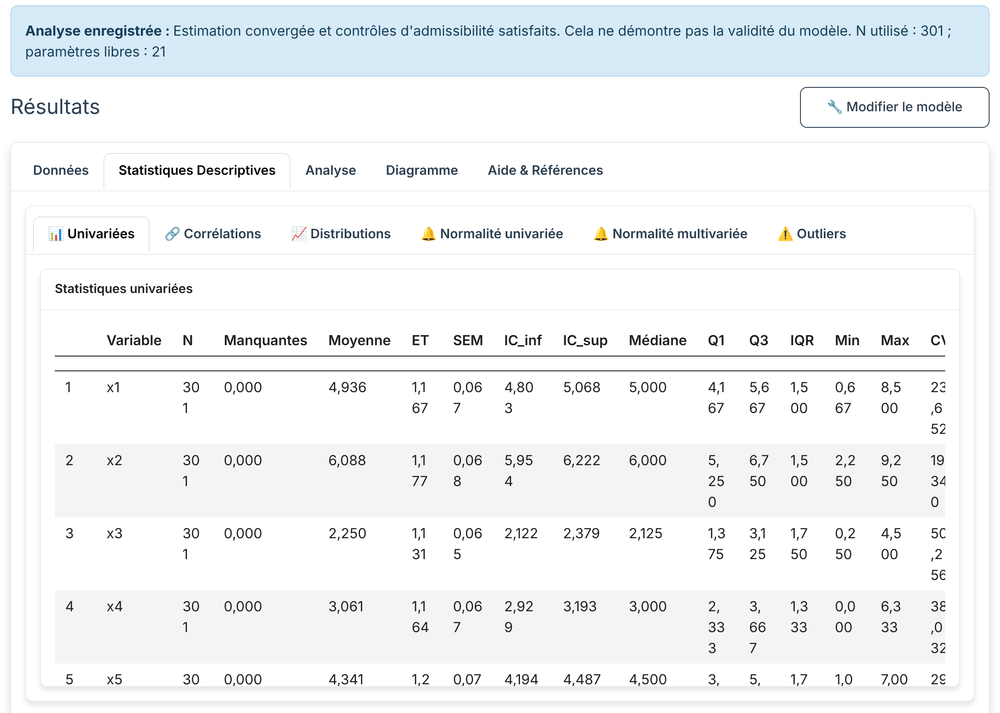
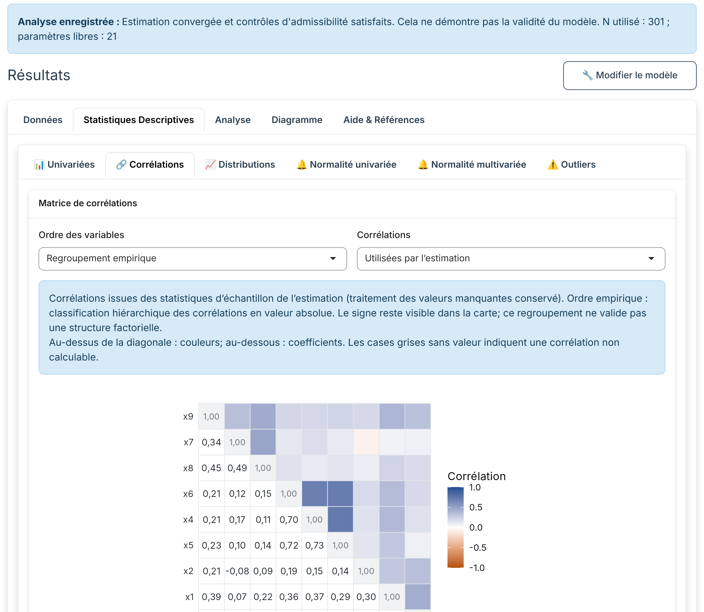
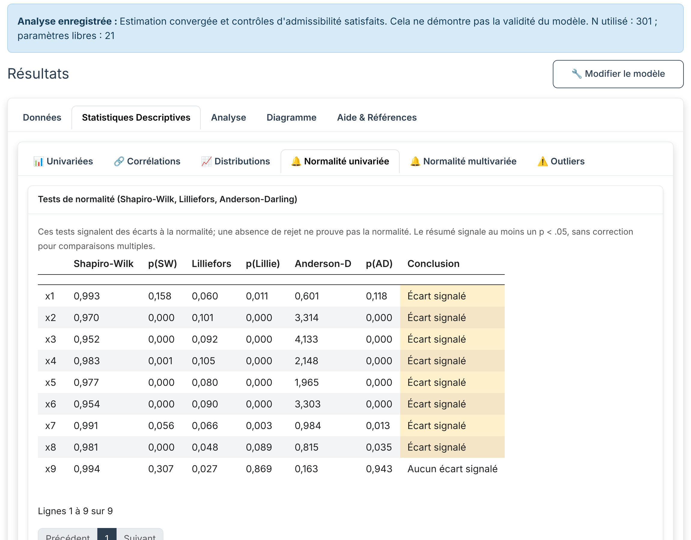
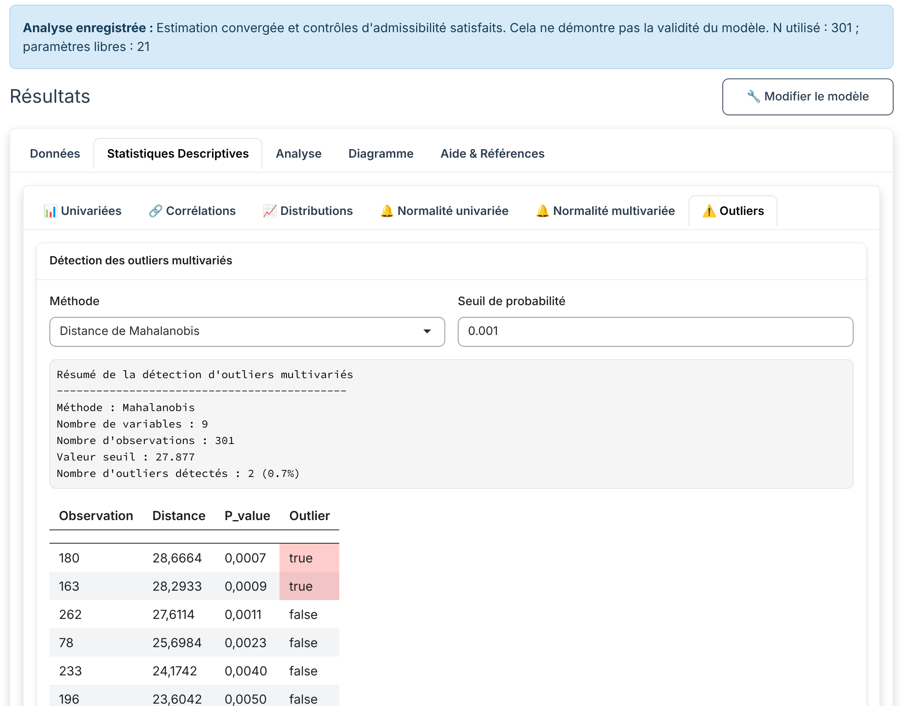
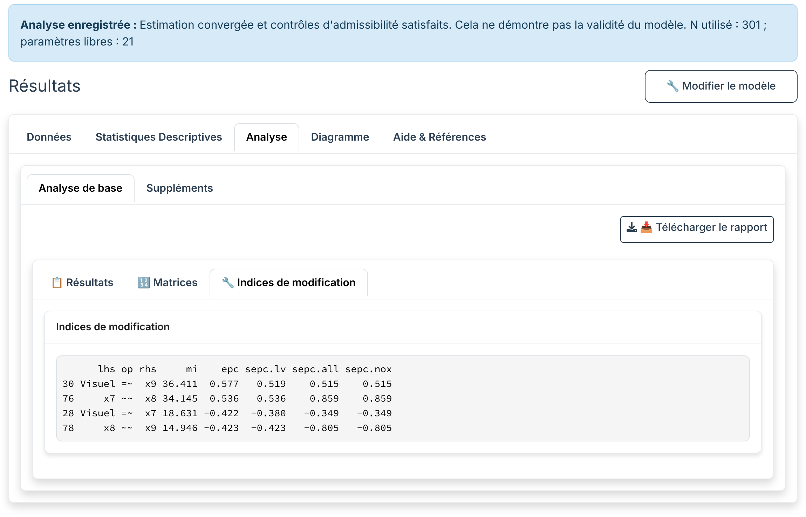

# Examiner les données et comprendre les signaux {#sec-diagnostics}

```{r}
#| include: false
source("_common.R")
UNI <- REF$hs_uni; OUT <- REF$hs_out; MI <- REF$hs$mi
Rr <- REF$hs$resid; Rl <- Rr; Rl[upper.tri(Rl, diag = TRUE)] <- NA
o <- order(-abs(Rl)); top <- data.frame(i = rownames(Rl)[row(Rl)[o]], j = colnames(Rl)[col(Rl)[o]], r = Rl[o])[1:5, ]
Z <- REF$hs$resid_z; Z[upper.tri(Z, diag = TRUE)] <- NA
nz <- sum(abs(Z) > 1.96, na.rm = TRUE)
MV <- REF$hs_mvn
```

::: {.callout-note title="Objectifs du chapitre"}
- Utiliser les statistiques descriptives et la carte des corrélations pour répondre à une question précise.
- Interpréter les tests de normalité sans en faire un vote.
- Examiner les observations éloignées sans les supprimer mécaniquement.
- Localiser les écarts du modèle par les résidus et les indices de modification.
:::

::: {.callout-tip title="Idée centrale"}
Un indice global dit *si* le modèle s’écarte des données; les résidus et les indices de modification disent *où*. Aucun diagnostic n’autorise une modification par lui-même : il pose une question que le contenu des indicateurs doit trancher.
:::

## Une inspection qui répond à des questions

Les diagnostics sont utiles lorsqu’ils éclairent une difficulté précise : variable mal codée, dispersion insuffisante, relation inattendue, distribution particulière ou écart entre deux indicateurs que le modèle ne reproduit pas. Parcourir mécaniquement tous les tests sans revenir à la question de mesure produit beaucoup de résultats et peu d’information.

Pour suivre ce chapitre, rechargez le modèle HS à trois facteurs. Avant d’estimer, fixez **Indices de modification : seuil** à 10 dans **Modèle & Spécification** : la section sur les indices de modification en aura besoin. Estimez ensuite avec les réglages de la première analyse.

## Statistiques univariées et distributions

Dans **Statistiques Descriptives → Univariées**, examinez le nombre d’observations disponibles, la dispersion et les valeurs extrêmes. Une variable constante ne peut pas contribuer normalement à une analyse de covariance. Une valeur hors de l’échelle prévue doit d’abord être vérifiée dans la documentation du fichier.

{#fig-app-univariees width=100%}

Dans **Distributions**, sélectionnez les variables et le type de graphique. L’histogramme montre la répartition en classes; la densité donne une représentation lissée; la boîte à moustaches aide à repérer la position, la dispersion et certaines observations éloignées. L’aspect dépend aussi de l’échelle et des choix graphiques. Une distribution visuellement asymétrique n’est pas une faute de saisie par définition.

Ne mélangez pas les variables de nature différente. Les catégories 0 à 3 d’un adjectif du MSQ n’ont pas à ressembler à une courbe continue normale. Leur inspection appelle d’abord une réflexion sur les catégories, leur fréquence et leur ordre.

## La carte des corrélations

Dans **Corrélations**, le triangle supérieur utilise des couleurs et le triangle inférieur affiche les coefficients. Le signe doit rester lisible : une forte relation négative est forte en valeur absolue, mais son sens est opposé à celui d’une relation positive.

{#fig-app-correlations width=100%}

L’ordre peut suivre un **regroupement empirique**, les **facteurs définis** ou l’**ordre d’origine**. Le regroupement empirique rapproche les variables selon les corrélations en valeur absolue. Il peut donc rapprocher deux items de sens opposé. Il ne constitue pas une analyse factorielle exploratoire ni une preuve que les facteurs annoncés sont les bons.

Choisissez aussi la base des corrélations. Les corrélations **utilisées par l’estimation** peuvent être polychoriques ou polysériales avec des variables ordinales; les corrélations de **Pearson** portent sur les scores numériques observés. Une différence entre ces bases n’est pas nécessairement une erreur de calcul. Annoncez celle que vous décrivez.

## Normalité univariée

L’onglet réunit **Shapiro–Wilk**, **Lilliefors** et **Anderson–Darling** pour les indicateurs continus. Leurs hypothèses et sensibilités diffèrent. L’absence de rejet ne prouve pas que la population est normale. Plusieurs tests sur plusieurs indicateurs augmentent aussi la possibilité de rencontrer une petite valeur de p.

Sur les neuf tests HS, Shapiro–Wilk rejette la normalité à 0,05 pour `r sum(UNI$SW_p < .05)` indicateurs. Les asymétries restent pourtant modestes, de `r v(min(UNI$Asymetrie), 2)` à `r v(max(UNI$Asymetrie), 2)`, et l’aplatissement le plus marqué vaut `r v(UNI$Aplatissement[which.max(abs(UNI$Aplatissement))], 2)` (`r UNI$Item[which.max(abs(UNI$Aplatissement))]`). Avec `r REF$hs$n` élèves, de petits écarts suffisent à faire rejeter le test : la taille de l’écart compte davantage que la valeur de p.

{#fig-app-normuni width=100%}

Certains tests imposent des conditions d’effectif. Par exemple, Shapiro–Wilk n’est pas calculé ici au-delà de 5 000 observations disponibles pour un indicateur. Une case non calculée n’est pas un résultat favorable. Les tests utilisent les valeurs non manquantes de chaque indicateur : leur effectif peut varier d’une variable à l’autre.

**Lorsque tous les indicateurs sont déclarés ordinaux, une note remplace le tableau.** Aucun test continu de normalité n’est calculé sur leurs catégories. Pour un modèle mixte, seules les variables continues apparaissent dans le tableau et une note annonce l’exclusion des variables ordinales.

## Normalité multivariée

La normalité de chaque variable ne suffit pas à garantir la normalité conjointe. L’onglet **Normalité multivariée** réunit cinq méthodes : Henze–Zirkler, Mardia, Royston, Doornik–Hansen et Énergie. Mardia comporte deux volets, asymétrie et aplatissement, d’où la possibilité d’obtenir six lignes pour cinq méthodes.

```{r}
#| label: tbl-hs-mvn
#| tbl-cap: !expr 'paste0("Normalité multivariée des neuf tests HS (", (if (!is.null(MV)) MV$n_used else REF$hs$n), " cas complets), telle que la présente l’application.")'
if (!is.null(MV)) {
  d <- MV$table[, c("Méthode", "Volet", "Statistique", "p", "Lecture")]
  tab(d, 3)
}
```

Les méthodes sont appliquées au même ensemble de cas complets. Le nombre utilisé est indiqué. Si une méthode est indisponible ou ne peut pas être calculée, son statut doit être lu comme tel. L’absence du package facultatif requis dans l’environnement ne constitue pas une conclusion sur les données.

Ces diagnostics ne forment pas un vote : trois tests non significatifs contre deux significatifs ne « prouveraient » pas la normalité. Sur HS, `r if (!is.null(MV)) sum(grepl("Écart", MV$table$Lecture)) else "toutes les"` lignes sur `r if (!is.null(MV)) nrow(MV$table) else "six"` signalent un écart; cette concordance justifie de garder à l’esprit l’option **ML robuste** présentée au chapitre précédent. Avec des indicateurs ordinaux, les tests continus ne sont pas applicables. L’analyse ordinale repose sur un modèle de réponses latentes qui n’exige pas une distribution normale des catégories observées.

## Observations éloignées

L’onglet **Outliers** propose la distance de Mahalanobis et une variante robuste fondée sur MCD. Ces diagnostics examinent des positions multivariées inhabituelles. Leur interprétation est surtout adaptée ici aux indicateurs continus. Un motif rare de catégories ordinales ne doit pas être supprimé mécaniquement sur la base de ces distances.

Avec le seuil de probabilité par défaut de 0,001 et neuf indicateurs, la distance critique vaut `r v(OUT$seuil, 2)`. Sur HS, la distance classique signale `r OUT$classique` élèves et la variante robuste en signale `r OUT$robuste`. L’écart entre les deux n’est pas une contradiction : la version robuste estime le centre et la dispersion sans se laisser tirer par les observations les plus éloignées, si bien qu’elle en repère davantage.

{#fig-app-outliers width=100%}

Le calcul utilise des cas complets et nécessite une covariance exploitable. L’effectif peut donc différer de celui d’une estimation FIML. Le repère issu du chi carré, particulièrement pour la variante robuste, reste un repère d’approximation. Une petite valeur de p est une invitation à vérifier, pas une autorisation de supprimer une personne.

Avant toute exclusion, demandez-vous si la valeur est impossible, si elle provient d’une erreur documentée ou si elle représente une observation réelle. Consignez la règle et comparez les conclusions avec et sans l’exclusion lorsque cette comparaison est justifiée.

## Résidus du modèle

Les matrices observées résument les relations dans les données; les matrices implicites décrivent celles que le modèle reproduit. Un résidu met en évidence leur différence dans la métrique choisie. Les résidus de corrélation et leurs valeurs standardisées ne se lisent pas avec les mêmes unités.

Dans **Modèle & Spécification → Affichage des résultats et matrices**, cochez les matrices souhaitées (**Covariances** et **Corrélations** : observée, implicite, résiduelle, résiduelle standardisée), puis revenez à **Analyse → Analyse de base → Matrices**. Les choix de matrices et le seuil des indices de modification changent la présentation de l’analyse enregistrée, sans réestimer ses paramètres. À l’inverse, modifier la structure, la nature des indicateurs, l’estimateur ou la gestion des absences nécessite une nouvelle estimation.

```{r}
#| label: fig-residus
#| fig-cap: "Résidus de corrélation du modèle de référence (corrélation observée moins corrélation reproduite). Les cases encadrées dépassent 0,10 en valeur absolue. Les plus grands écarts relient deux tests de vitesse aux tests visuels : positifs pour x9 (le modèle sous-estime ces relations), négatifs pour x7 (il les surestime)."
#| fig-width: 6
#| fig-height: 4.8
n <- nrow(Rr); cells <- expand.grid(i = seq_len(n), j = seq_len(n)); cells$r <- Rr[cbind(cells$i, cells$j)]
cells <- cells[cells$i > cells$j, ]
cells$x <- colnames(Rr)[cells$j]; cells$y <- rownames(Rr)[cells$i]
cells$x <- factor(cells$x, levels = colnames(Rr)); cells$y <- factor(cells$y, levels = rev(rownames(Rr)))
ggplot(cells, aes(x, y, fill = r)) + geom_tile(colour = "white") +
  geom_tile(data = cells[abs(cells$r) > .10, ], colour = "black", linewidth = .6, fill = NA) +
  geom_text(aes(label = v(r, 2)), size = 3.2) +
  scale_fill_gradient2(low = PAL[["orange"]], mid = "white", high = PAL[["bleu"]], limits = c(-.2, .2),
                       oob = scales::squish, name = "Résidu", labels = function(x) v(x, 1)) +
  coord_equal() + labs(x = NULL, y = NULL) + theme_manuel(11) + theme(panel.grid = element_blank())
```

Un résidu positif entre deux indicateurs signifie que le modèle reproduit moins de relation qu’il n’en est observé pour cette paire; un résidu négatif, qu’il en reproduit trop. Sur HS, le plus grand résidu de corrélation concerne `r top$i[1]` et `r top$j[1]` (`r v(top$r[1], 3)`), suivi de `r top$i[2]`–`r top$j[2]` (`r v(top$r[2], 3)`) et de `r top$i[3]`–`r top$j[3]` (`r v(top$r[3], 3)`). Parmi les 36 résidus standardisés, `r nz` dépassent 1,96 en valeur absolue. Examinez les intitulés de la matrice pour savoir s’il s’agit de covariances, de corrélations ou de résidus standardisés. Ne comparez pas directement un nombre dans une matrice brute à un seuil destiné à une valeur z.

## Indices de modification

Un indice de modification estime localement l’amélioration possible du chi carré si un paramètre actuellement restreint était libéré. L’**EPC** décrit le changement de paramètre attendu. Les colonnes standardisées donnent d’autres échelles de lecture. Une valeur élevée ne fournit pas une justification théorique [@lavaanmi].

Pour afficher ce panneau, fixez **Indices de modification : seuil** à 10 plutôt qu’à `Inf`, estimez, puis ouvrez **Analyse de base → Indices de modification**. `Inf` masque ces indices; ce n’est pas un seuil de significativité.

```{r}
#| label: tbl-hs-mi
#| tbl-cap: "Indices de modification supérieurs à 10 pour le modèle de référence. EPC : changement attendu du paramètre; EPC std : sa version entièrement standardisée."
d <- MI; names(d) <- c("Gauche", "Op.", "Droite", "MI", "EPC", "EPC std")
tab(d, 3)
```

{#fig-app-mi width=100%}

Sur HS, deux propositions dominent : une saturation croisée de `x9` sur le facteur visuel (MI = `r v(MI$mi[1], 1)`) et une covariance résiduelle entre `x7` et `x8` (MI = `r v(MI$mi[2], 1)`). Elles racontent deux histoires différentes. La première dit que la discrimination rapide de lettres demande aussi une aptitude visuelle; la seconde, que l’addition et le comptage rapides partagent quelque chose que le facteur vitesse ne contient pas, par exemple un format de tâche chronométrée. Écrivez d’abord ce qu’une telle modification signifierait. Ajouter successivement toutes les propositions élevées adapte le modèle à cet échantillon et peut réduire sa portée confirmatoire.

## Laboratoire : localiser un écart

1. Sur le modèle HS, cochez les corrélations **Résiduelle** et **Résiduelle Std** dans **Affichage des résultats et matrices**, fixez le seuil des indices de modification à 10, puis estimez.
2. Repérez la paire d’indicateurs dont le résidu de corrélation est le plus grand en valeur absolue.
3. Comparez avec les deux plus grands indices de modification.
4. Choisissez l’une des deux modifications proposées et rédigez en deux phrases la justification de contenu qu’elle exigerait.

::: {.callout-tip title="Réponse" collapse="true"}
Le plus grand résidu touche `r top$i[1]` et `r top$j[1]` (`r v(top$r[1], 3)`). Les deux plus grands indices de modification proposent `Visuel =~ x9` (`r v(MI$mi[1], 1)`) et `x7 ~~ x8` (`r v(MI$mi[2], 1)`). Les deux lectures concordent : le bloc vitesse est le moins bien reproduit.

Pour `x7 ~~ x8` : « L’addition et le comptage de points sont deux tâches chronométrées d’exécution simple et répétitive; une composante de vitesse d’exécution propre à ce format pourrait les lier au-delà du facteur général de vitesse. Cette relation n’était pas prévue et devrait être vérifiée dans un autre échantillon. » Le chapitre sur les contraintes montre comment l’ajouter et ce qu’elle change.
:::

::: {.callout-important title="À retenir"}
- Un diagnostic répond à une question; il ne vote pas et n’autorise aucune modification automatique.
- Avec un effectif important, les tests de normalité rejettent de petits écarts : regardez l’ampleur.
- Une observation éloignée se vérifie avant de s’exclure.
- Résidus et indices de modification localisent les écarts; le contenu décide.
:::

## Quiz

1. Le regroupement empirique de la carte des corrélations confirme-t-il la structure à trois facteurs ?
2. Les tests de normalité multivariée rejettent tous l’hypothèse. Faut-il abandonner l’AFC ?
3. Le seuil des indices de modification est à `Inf`. Le modèle n’a-t-il donc aucun écart local ?
4. Un indice de modification vaut 36. Suffit-il pour ajouter le paramètre ?

::: {.callout-tip title="Réponses" collapse="true"}
1. Non. Il réordonne les variables selon leurs corrélations; il ne teste pas un modèle.
2. Non. On peut employer un estimateur robuste et vérifier que les conclusions tiennent; l’écart de distribution n’invalide pas la structure.
3. Non. `Inf` masque simplement le tableau.
4. Non. Il indique un gain d’ajustement possible; le paramètre doit avoir un sens substantiel et sa découverte a posteriori doit être annoncée.
:::
