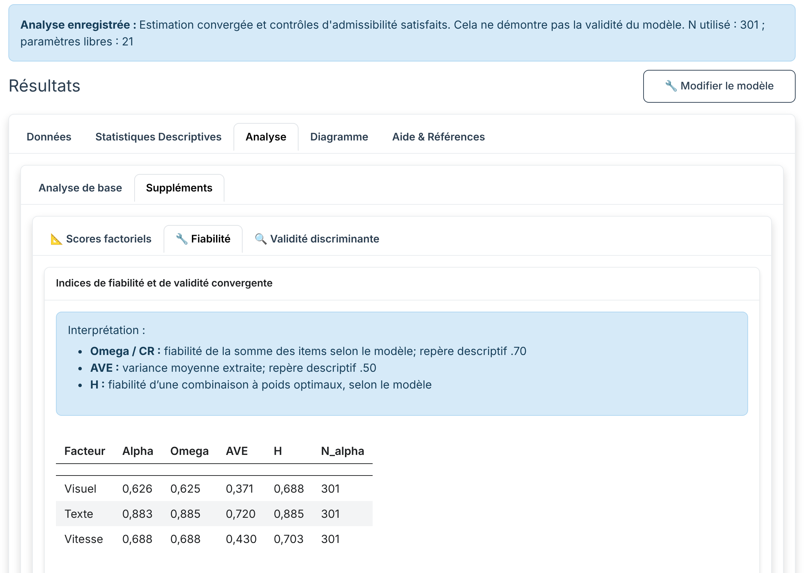
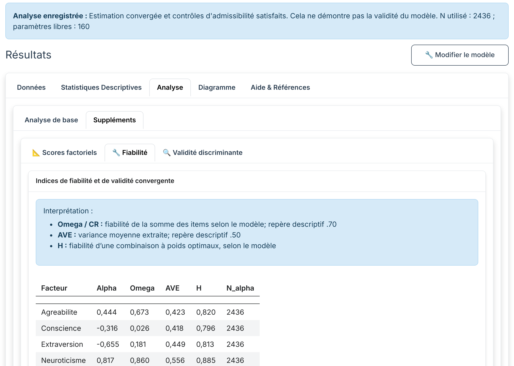

# Comprendre ce que les indices de fiabilité évaluent {#sec-fiabilite}

```{r}
#| include: false
source("_common.R")
F <- REF$hs$val$results
f <- function(fac, col) F[[col]][F$Facteur == fac]
B <- REF$bfi$val$results
bs <- REF$bfi$sat
neg <- bs[bs$Std < 0, ]
F78 <- REF$hs78$val$results
```

::: {.callout-note title="Objectifs du chapitre"}
- Préciser le score dont on évalue la fiabilité : somme brute, combinaison pondérée ou réponse latente.
- Distinguer alpha, oméga (CR), H et AVE, et lire leurs écarts.
- Comprendre l’effet d’une covariance résiduelle et des items inversés sur la fiabilité d’une somme.
- Situer les repères 0,70 et 0,50 par rapport à l’usage visé.
:::

::: {.callout-tip title="Idée centrale"}
« Quelle est la fiabilité ? » est une question incomplète. Il faut d’abord dire **de quel score** : la somme des items, une somme pondérée ou la réponse latente. Chaque indice répond pour un score différent; leurs écarts renseignent sur les indicateurs.
:::

## La question porte sur un score

Une structure factorielle et un score fiable sont deux questions liées, mais distinctes. Le modèle décrit les relations entre les indicateurs. La fiabilité concerne la proportion de variance attribuable à la composante visée pour un score défini. Il faut donc préciser si l’on parle d’une somme, d’une moyenne, d’une combinaison pondérée ou d’une réponse latente.

Deux règles pratiques en découlent. D’abord, une fiabilité élevée ne prouve pas l’unidimensionnalité. Ensuite, un indice fondé sur un modèle dépend de la pertinence de ce modèle. Calculer une valeur très précise à partir d’une structure mal spécifiée ne résout pas la difficulté de mesure [@mcdonald1999].

| Indice | Score visé | Calculé sur | Hypothèse principale |
|---|---|---|---|
| Alpha | Somme des items observés | Covariances observées, cas complets | Contributions égales des items, pas de covariance résiduelle |
| Oméga (CR) | Somme des items, dans leurs unités | Paramètres du modèle | Le modèle de mesure est correct |
| H | Combinaison pondérée de façon optimale | Paramètres du modèle | Idem; poids choisis par le modèle |
| AVE | Aucun score : moyenne par indicateur | Saturations standardisées | Structure simple |

## Où lire les résultats

Rechargez et estimez le modèle HS à trois facteurs. Dans **Analyse → Suppléments → Fiabilité**, le tableau présente notamment **Alpha**, **Omega**, **CR**, **AVE** et **H**. Les notes sous le tableau précisent la cible du calcul et les limites.

{#fig-app-fiabilite width=100%}

Voici les repères pour cette analyse :

```{r}
#| label: tbl-hs-fiab
#| tbl-cap: "Indices de fiabilité et de validité convergente du modèle de référence (moteur de l’application). Omega et CR désignent la même quantité."
d <- F[, c("Facteur", "Alpha", "Omega", "AVE", "H", "N_alpha")]; d$N_alpha <- as.integer(d$N_alpha)
tab(d)
```

```{r}
#| label: fig-hs-fiab
#| fig-cap: "Alpha, oméga et H par facteur, avec le repère descriptif de 0,70. L’écart entre H et oméga est le plus grand pour le facteur visuel, dont les indicateurs contribuent le plus inégalement."
#| fig-height: 3.4
d <- do.call(rbind, lapply(c("Alpha", "Omega", "H"), function(k) data.frame(Facteur = F$Facteur, Indice = k, Valeur = F[[k]])))
d$Indice <- factor(d$Indice, levels = c("Alpha", "Omega", "H"), labels = c("Alpha", "Oméga", "H"))
d$Facteur <- factor(d$Facteur, levels = F$Facteur)
ggplot(d, aes(Facteur, Valeur, fill = Indice)) + geom_col(position = position_dodge(.75), width = .7) +
  geom_hline(yintercept = .70, linetype = 2, colour = PAL["gris"]) +
  geom_text(aes(label = v(Valeur, 2)), position = position_dodge(.75), vjust = -.4, size = 3) +
  scale_fill_manual(values = unname(PAL[c("clair", "bleu", "orange")])) +
  scale_y_continuous(limits = c(0, 1), labels = function(x) v(x, 1)) +
  labs(x = NULL, y = NULL, fill = NULL) + theme_manuel()
```

Le facteur verbal (`Texte`) est mesuré plus fortement et plus régulièrement que le facteur visuel dans cette spécification : oméga `r v(f("Texte", "Omega"))` contre `r v(f("Visuel", "Omega"))`. La fiabilité de la somme des trois indicateurs visuels reste modeste. Cette observation peut refléter les propriétés des tests, leur nombre et les limites du modèle.

## Alpha

Alpha est calculé sur les scores observés. Il dépend des covariances entre items et de leur nombre. Sa lecture comme fiabilité d’un score requiert des hypothèses; il n’établit pas que tous les indicateurs mesurent une seule dimension.

L’application indique **N_alpha**, le nombre de cas complets pour les indicateurs du facteur considéré. Il peut différer entre facteurs et de l’effectif d’une estimation FIML. Une comparaison entre alpha et oméga doit donc tenir compte à la fois de leur définition et des observations utilisées.

Une grande quantité d’items très redondants peut augmenter alpha sans améliorer proportionnellement la couverture du construit. Inversement, un petit ensemble couvrant des contenus complémentaires peut avoir une valeur plus faible. La décision de retenir un score ne se réduit pas à maximiser cet indice.

## Oméga et CR

Dans cette application, **Omega** et **CR** désignent la même quantité calculée pour la somme des indicateurs, dans leurs unités d’origine, selon le modèle. Ce ne sont pas deux preuves indépendantes.

Pour un facteur de variance $\phi$, des saturations $\boldsymbol{\lambda}$ et une matrice résiduelle $\Theta$, la formule utilisée est :

$$\omega=\frac{\phi(\sum_i\lambda_i)^2}{\phi(\sum_i\lambda_i)^2+\boldsymbol{1}^{\mathsf T}\Theta\boldsymbol{1}}.$$

La matrice résiduelle complète intervient au dénominateur. Une covariance résiduelle peut donc modifier la fiabilité de la somme; elle ne doit pas disparaître d’un calcul simplifié. La variance totale au dénominateur est celle reproduite par le modèle pour ce score.

L’effet est net sur HS. Si l’on ajoute la covariance résiduelle entre `x7` et `x8` suggérée au chapitre précédent, l’oméga du facteur vitesse passe de `r v(f("Vitesse", "Omega"))` à `r v(F78$Omega[F78$Facteur == "Vitesse"])`, alors qu’alpha, calculé sur les seules covariances observées, ne bouge pas (`r v(F78$Alpha[F78$Facteur == "Vitesse"])`). Une partie de ce que `x7` et `x8` partagent est désormais attribuée à leur lien propre plutôt qu’au facteur : la somme des trois tests mesure moins bien la vitesse qu’on ne le croyait. H, lui, monte à `r v(F78$H[F78$Facteur == "Vitesse"])`, parce qu’une pondération optimale peut exploiter la structure des erreurs; ce score pondéré s’éloigne alors de la somme qu’on utilisera.

Cette formule suppose que le score visé est effectivement la somme des items dans le codage analysé. Si certaines saturations sont négatives parce que des items sont orientés en sens inverse, leur compensation peut réduire fortement la composante commune de la somme. Ce n’est pas une anomalie à masquer en prenant toutes les saturations en valeur absolue.

## H

**H** décrit une combinaison à poids optimaux selon le modèle [@hancock2001]. Sa cible est différente de celle d’une somme à poids égaux. Une valeur de H supérieure à celle d’oméga n’implique pas que la somme utilisée dans votre recherche possède cette fiabilité plus élevée.

Dans le modèle simple, le calcul peut s’écrire $H=a/(1+a)$, où $a=\phi\boldsymbol{\lambda}^{\mathsf T}\Theta^{-1}\boldsymbol{\lambda}$. Cette écriture explique pourquoi la covariance résiduelle et la qualité respective des indicateurs interviennent. Elle n’impose pas de calcul manuel au lecteur.

Sur HS, la différence entre H et oméga est plus visible pour le facteur visuel (`r v(f("Visuel", "H"))` contre `r v(f("Visuel", "Omega"))`) que pour le facteur verbal (`r v(f("Texte", "H"))` contre `r v(f("Texte", "Omega"))`). Les indicateurs visuels ne contribuent pas tous avec la même qualité : un score qui donnerait plus de poids à `x1` et moins à `x2` serait plus fiable que leur somme. Mentionnez la cible du coefficient avant de comparer leurs valeurs.

## AVE

La **variance moyenne extraite**, ou AVE, résume la proportion de variance des indicateurs attribuée au facteur. Dans une structure simple, elle est la moyenne des saturations entièrement standardisées au carré [@fornell1981]. Elle ne doit pas être lue comme le coefficient de fiabilité de la somme.

L’AVE du facteur verbal (`r v(f("Texte", "AVE"))`) est nettement supérieure à celle du facteur visuel (`r v(f("Visuel", "AVE"))`). L’interprétation est cohérente avec les saturations déjà observées. Le repère 0,50 exprime l’idée que le facteur explique en moyenne une part substantielle de la variance de ses indicateurs; il n’est pas une preuve autonome de validité convergente. Une AVE inférieure à 0,50 avec un oméga acceptable n’a rien de contradictoire : chaque indicateur est imparfait, mais leur somme l’est moins.

## Les repères ne remplacent pas l’usage visé

On rencontre souvent 0,70 pour la fiabilité et 0,50 pour l’AVE. Ces valeurs peuvent servir de points de discussion. Elles ne déterminent pas seules si un score convient à une comparaison de groupes, à une exploration pédagogique ou à une décision individuelle à enjeu important.

Examinez le contenu des items, la précision nécessaire, le nombre d’indicateurs, les erreurs-types disponibles et la stabilité dans d’autres échantillons. Un coefficient unique n’épuise pas la qualité d’un instrument.

## Attention aux items inversés du BFI

Le fichier BFI de l’application conserve le codage original. Les clés identifient notamment A1, C4, C5, E1, E2, O2 et O5 comme orientés en sens inverse. Une saturation négative peut être cohérente avec ce codage. Elle ne signifie pas automatiquement que l’item est mauvais. Dans le modèle préparé, `r nrow(neg)` saturations sont négatives : `r paste(neg$Item, collapse = ", ")`. Cette liste ne coïncide pas avec celle des items inversés, et c’est normal : avec **λ₁=1**, chaque facteur prend l’orientation de son premier item. Quand ce premier item est lui-même inversé (A1, E1), ce sont les items directs qui apparaissent négatifs. Le signe d’une saturation se lit donc toujours par rapport à l’item de référence.

```{r}
#| label: tbl-bfi-fiab
#| tbl-cap: !expr 'paste0("BFI / SAPA, codage d’origine (WLSMV, ", (ent(REF$bfi$n)), " cas complets). Alpha porte sur la somme des réponses observées; oméga, H et AVE portent sur les réponses latentes.")'
tab(B[, c("Facteur", "Alpha", "Omega", "AVE", "H")])
```

{#fig-app-fiab-bfi width=100%}

Le contraste est spectaculaire pour le facteur `Conscience` : alpha vaut `r v(B$Alpha[B$Facteur == "Conscience"])` et oméga `r v(B$Omega[B$Facteur == "Conscience"])`, alors que H atteint `r v(B$H[B$Facteur == "Conscience"])`. La somme brute additionne des items de sens opposés, qui s’annulent en partie; la combinaison optimale de H, elle, donne un poids négatif aux items inversés. Seuls `Neuroticisme`, dont aucun item n’est inversé, et dans une moindre mesure `Agreabilite`, gardent une somme brute interprétable.

Avant de calculer une somme orientée dans une direction commune, il faudrait recoder les items concernés selon une règle explicite, puis réestimer et documenter l’analyse. Pour une échelle allant de 1 à 6, l’inversion usuelle est $7-X$. Cette opération modifie le score défini. L’application ne l’accomplit pas silencieusement à votre place.

## Avec des indicateurs ordinaux

Dans les analyses ordinales de cette application, oméga, CR, H et AVE portent sur les **réponses latentes continues** qui sous-tendent les catégories. Alpha porte sur les scores observés. Les différences entre ces coefficients ne sont donc pas seulement des différences de méthodes de calcul sur une même cible.

Vous ne pouvez pas affirmer que la somme observée de dix catégories possède une fiabilité de 0,94 uniquement parce que l’oméga de la réponse latente vaut 0,94. Le chapitre sur les données ordinales reviendra sur cette distinction. Conservez-la déjà lorsque vous lisez les tableaux du MSQ ou du BFI.

## Laboratoire : quatre phrases sur une même analyse

À partir du tableau HS, rédigez quatre phrases : une sur la somme des indicateurs visuels, une sur le facteur verbal, une distinguant H d’oméga et une précisant pourquoi la convergence n’établit pas la fiabilité. Évitez d’additionner les arguments Omega et CR comme s’ils constituaient deux observations séparées.

::: {.callout-tip title="Réponse" collapse="true"}
1. « La somme des trois tests visuels a une fiabilité modeste selon le modèle (oméga = `r v(f("Visuel", "Omega"))`), sous le repère usuel de 0,70. »
2. « Les trois tests verbaux forment un score fiable (oméga = `r v(f("Texte", "Omega"))`; AVE = `r v(f("Texte", "AVE"))`). »
3. « Pour le facteur visuel, H (`r v(f("Visuel", "H"))`) dépasse oméga : une pondération qui favoriserait `x1` améliorerait la fiabilité, mais ce ne serait plus la somme simple. »
4. « Une estimation convergée et admissible permet de calculer ces indices; elle ne dit pas si les scores sont assez fiables pour l’usage visé. »
:::

::: {.callout-important title="À retenir"}
- Dire de quel score on parle avant de citer une fiabilité.
- Oméga et CR sont ici la même quantité; alpha porte sur les données, oméga et H sur le modèle.
- Une covariance résiduelle diminue l’oméga de la somme et peut gonfler H.
- Des items inversés non recodés peuvent ruiner la fiabilité d’une somme brute sans affaiblir le facteur.
:::

## Quiz

1. Alpha et oméga sont presque égaux pour le facteur `Texte`. Qu’est-ce que cela suggère sur ses indicateurs ?
2. Peut-on citer H pour décrire la fiabilité de la moyenne des items d’une échelle ?
3. L’AVE du facteur `Vitesse` vaut `r v(f("Vitesse", "AVE"))`. Ses indicateurs sont-ils inutilisables ?
4. Pourquoi un alpha négatif ne doit-il pas être ramené à zéro ?

::: {.callout-tip title="Réponses" collapse="true"}
1. Que les trois tests contribuent de façon semblable au facteur : l’hypothèse de contributions égales d’alpha est alors peu violée.
2. Non. H décrit une combinaison pondérée de façon optimale, pas une moyenne à poids égaux.
3. Non. Chaque test garde une part substantielle de variance propre, mais leur somme a un oméga de `r v(f("Vitesse", "Omega"))`. L’AVE décrit les indicateurs un à un.
4. Il signale que la somme brute n’a pas de cohérence interprétable, souvent à cause d’items inversés; le masquer cacherait un problème de définition du score.
:::
