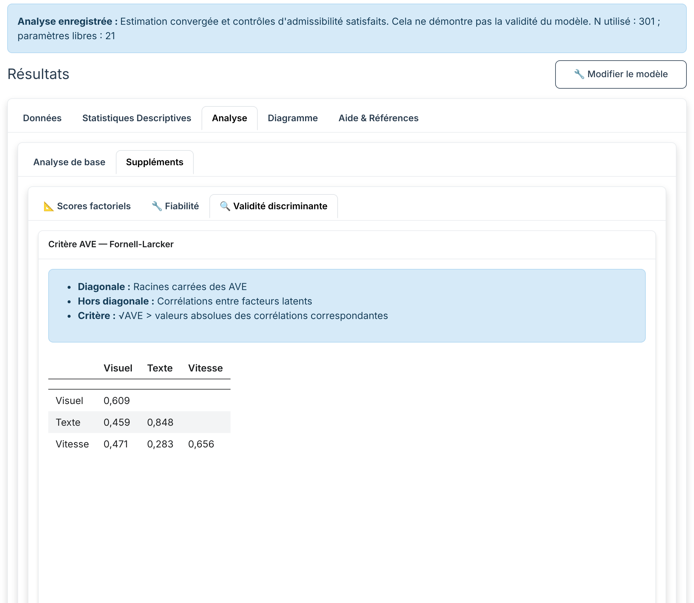
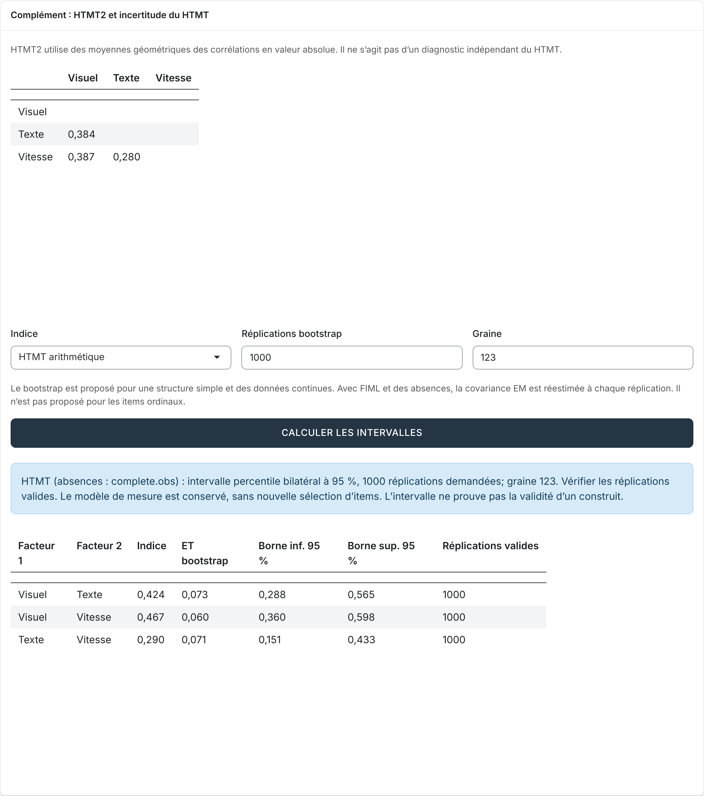

# Examiner la distinction entre les facteurs {#sec-validite}

```{r}
#| include: false
source("_common.R")
V <- REF$hs$val; H <- V$HTMT; H2 <- REF$hs$htmt2; C <- REF$hs$cor
BT <- REF$hs_boot$table
paires <- data.frame(Paire = c("Visuel – Texte", "Visuel – Vitesse", "Texte – Vitesse"),
                     r = C[upper.tri(C)], HTMT = H[upper.tri(H)], HTMT2 = t(H2)[upper.tri(H2)])
pol <- REF$PoliticalDemocracy
```

::: {.callout-note title="Objectifs du chapitre"}
- Lire les corrélations entre facteurs, le critère de Fornell et Larcker, le HTMT et le HTMT2.
- Comprendre ce que chaque critère compare et sur quelle matrice il est calculé.
- Ajouter une information d’incertitude par bootstrap.
- Formuler une conclusion prudente sur la distinction des construits.
:::

::: {.callout-tip title="Idée centrale"}
Deux facteurs liés peuvent rester distincts. Les critères de validité discriminante comparent, chacun à sa façon, ce que les indicateurs d’un facteur partagent entre eux et ce qu’ils partagent avec ceux d’un autre facteur. Ils renseignent sur la séparation empirique; le sens des construits reste une question de contenu.
:::

## Des facteurs liés peuvent rester distincts

Deux construits peuvent être fortement associés sans être interchangeables. L’AFC à facteurs corrélés permet d’examiner cette possibilité. Mais une étiquette différente sur chaque cercle du diagramme ne suffit pas à établir que les dimensions sont empiriquement distinguables.

La validité discriminante demande une lecture des corrélations factorielles, des relations entre items, de leur contenu et de l’incertitude. Les indices présentés ici sont des éléments du raisonnement. Ils ne remplacent pas l’examen conceptuel des construits.

## Corrélations factorielles

Commencez par les corrélations estimées entre facteurs. Une valeur proche de 1 en valeur absolue appelle une attention particulière. Une valeur hors de l’intervalle admissible, une matrice factorielle problématique ou une solution inadmissible empêchent une lecture ordinaire de ces coefficients.

Ne confondez pas une covariance avec une corrélation. La première dépend des échelles factorielles; la seconde exprime une relation standardisée. Une covariance plus grande après changement d’identification ne signifie pas nécessairement un lien substantiel plus fort.

Dans HS, les corrélations entre les trois facteurs vont de `r v(min(paires$r))` à `r v(max(paires$r))`, sans être imposées parfaites. Leur sens est cohérent avec des aptitudes cognitives associées. La question reste de savoir si leurs indicateurs permettent de défendre les distinctions proposées.

## Le tableau AVE de Fornell et Larcker

Ouvrez **Analyse → Suppléments → Validité discriminante**. La diagonale du premier tableau contient les racines carrées des AVE. Les valeurs hors diagonale sont les corrélations factorielles. Le critère compare la racine carrée de l’AVE aux corrélations correspondantes en **valeur absolue** [@fornell1981].

```{r}
#| label: tbl-fl
#| tbl-cap: "Critère de Fornell et Larcker pour le modèle de référence : racine carrée de l’AVE sur la diagonale, corrélations entre facteurs sous la diagonale."
FL <- V$FL; d <- data.frame(Facteur = rownames(FL), FL, check.names = FALSE)
d[-1] <- lapply(d[-1], function(x) ifelse(is.na(x), "", v(x))); knitr::kable(d, align = c("l", "r", "r", "r"), row.names = FALSE)
```

{#fig-app-validite width=100%}

Chaque racine d’AVE dépasse ici les corrélations de sa ligne et de sa colonne : par exemple, pour `Visuel`, `r v(sqrt(V$results$AVE[1]))` contre `r v(C["Visuel", "Texte"])` et `r v(C["Visuel", "Vitesse"])`. Ce critère équivaut à demander que l’AVE dépasse la MSV, le plus grand carré des corrélations du facteur (colonnes **MSV** et **ASV** du tableau de fiabilité).

Par exemple, une corrélation de −0,80 est plus forte en valeur absolue qu’une racine d’AVE de 0,70; le signe négatif ne rend pas le critère favorable. La comparaison doit être faite pour chacun des deux facteurs d’une paire.

Un critère satisfait ne démontre pas à lui seul la validité discriminante. Il synthétise un aspect de la relation entre variance extraite et chevauchement des facteurs. Il est aussi très exigeant lorsque les saturations sont modérées : avec une AVE de 0,30, une corrélation de 0,55 entre facteurs suffit à le faire échouer.

## HTMT

Le **HTMT** compare l’intensité des corrélations entre indicateurs de facteurs différents à celle des corrélations entre indicateurs d’un même facteur. Il est calculé ici à partir des corrélations des données utilisées par l’estimation, et non à partir d’une matrice de corrélations reproduite par le modèle : c’est ce qui en fait un contrôle indépendant de l’estimation.

$$\text{HTMT}_{ij}=\frac{\bar r_{ij}}{\sqrt{\bar r_{ii}\,\bar r_{jj}}}$$

Le numérateur est la moyenne des corrélations entre un indicateur de $i$ et un indicateur de $j$; le dénominateur est la moyenne géométrique des corrélations moyennes entre indicateurs distincts d’un même facteur. L’application utilise les valeurs absolues des corrélations. Les repères 0,85 et 0,90 sont affichés comme points de lecture, plus ou moins exigeants. Ils ne font pas disparaître l’incertitude d’échantillonnage et ne constituent pas un verdict universel [@henseler2015].

Pour le modèle HS de référence :

```{r}
#| label: tbl-htmt
#| tbl-cap: "Corrélations entre facteurs, HTMT et HTMT2 du modèle de référence."
names(paires)[2] <- "Corrélation factorielle"; tab(paires)
```

```{r}
#| label: fig-htmt
#| fig-cap: "Corrélation entre facteurs, HTMT et HTMT2 pour les trois paires de HS. Les trois lectures restent loin du repère de 0,85 (ligne pointillée). Elles ne coïncident pas : le HTMT voit les données telles qu’elles sont, la corrélation factorielle passe par le modèle."
#| fig-height: 3.2
d <- do.call(rbind, lapply(c("Corrélation factorielle", "HTMT", "HTMT2"), function(k)
  data.frame(Paire = paires$Paire, Indice = k, Valeur = paires[[k]])))
ggplot(d, aes(Valeur, Paire, colour = Indice, shape = Indice)) +
  geom_vline(xintercept = .85, linetype = 2, colour = PAL["gris"]) +
  geom_point(size = 3.2, position = position_dodge(.5)) +
  scale_colour_manual(values = unname(PAL[c("bleu", "orange", "vert")])) +
  scale_x_continuous(limits = c(0, 1), labels = function(x) v(x, 1)) +
  labs(x = NULL, y = NULL, colour = NULL, shape = NULL) + theme_manuel()
```

Comparez ces valeurs aux corrélations factorielles, sans exiger qu’elles leur soient exactement égales. Les deux calculs utilisent des informations liées, mais leur construction diffère. Une valeur élevée doit conduire à examiner le contenu partagé, la qualité des indicateurs et les autres diagnostics.

Avec un seul facteur, il n’existe aucune paire de facteurs dont on pourrait examiner la distinction. L’absence de HTMT dans ce cas est attendue; ce n’est pas un échec de l’analyse.

## HTMT2

Le complément **HTMT2** est accessible en **Options avancées**, dans **4. Interpréter**. Il remplace les moyennes arithmétiques par des moyennes géométriques. Lorsque les saturations d’un même facteur sont inégales, le HTMT s’écarte de la corrélation vraie entre facteurs; le HTMT2 est conçu pour la retrouver dans ce cas. Il demeure un indice apparenté au HTMT, pas une validation indépendante [@roemer2021; @semtoolshtmt].

La présence de corrélations nulles ou non calculables peut rendre certaines valeurs indisponibles. Une case manquante doit être comprise à partir de cette définition, et non remplacée par zéro. Des indicateurs mal reliés à leur propre facteur peuvent aussi fragiliser la lecture du rapport de corrélations.

## Ajouter une information sur l’incertitude

Le panneau avancé permet de demander un intervalle bootstrap du HTMT ou du HTMT2. Ce calcul n’est pas lancé automatiquement. Choisissez l’indice, le nombre de réplications et la graine, puis cliquez sur **Calculer les intervalles**.

Pour une première utilisation sur HS, demandez **1 000 réplications** et la **graine 123**. Lisez l’intervalle percentile bilatéral à 95 %, mais aussi le nombre de réplications valides. Un intervalle large signifie que le point estimé ne décrit pas toute l’incertitude. Les bornes peuvent varier légèrement si le nombre de réplications ou l’environnement change.

```{r}
#| label: tbl-boot
#| tbl-cap: "Intervalles bootstrap percentile à 95 % du HTMT (1 000 réplications, graine 123), tels que les calcule l’application."
d <- BT[, c("facteur1", "facteur2", "htmt", "et_boot", "borne_inf", "borne_sup", "n_valides")]
names(d) <- c("Facteur 1", "Facteur 2", "HTMT", "ET bootstrap", "Borne inf.", "Borne sup.", "Réplications valides")
d$`Réplications valides` <- as.integer(d$`Réplications valides`); tab(d)
```

{#fig-app-bootstrap width=100%}

La borne supérieure la plus haute, `r v(max(BT$borne_sup))`, reste très loin de 0,85 : même en tenant compte de l’incertitude d’échantillonnage, aucune paire de facteurs HS n’approche du repère. Les intervalles sont pourtant larges (environ ± `r v(1.96 * mean(BT$et_boot), 2)`), ce qui rappelle qu’avec `r REF$hs$n` élèves une valeur ponctuelle reste approximative.

La proposition est limitée à une structure simple et à des indicateurs continus. Avec FIML et des absences, la covariance utilisée pour le HTMT est réestimée à chaque réplication. Le bootstrap proposé n’est pas disponible pour les items ordinaux : il faudrait notamment réestimer les corrélations catégorielles à chaque réplication selon une procédure adaptée.

Ne remplacez pas une analyse ordinale par une analyse continue uniquement pour débloquer ce bouton. Le choix de méthode doit rester fondé sur la nature des variables et la question.

## Ce que l’on peut conclure

Un résultat favorable peut soutenir l’idée que les ensembles d’indicateurs ne paraissent pas entièrement confondus dans cette analyse. Il ne prouve pas la validité globale de chaque construit. La validité concerne l’argumentation qui relie les réponses, le sens attribué aux scores et leur usage.

Une formulation prudente est : « Les corrélations factorielles et les estimations du HTMT ne suggèrent pas ici une confusion complète des dimensions. Cette observation est cohérente avec leur distinction, sous les limites du modèle et de l’échantillon. » Ajoutez les difficultés particulières lorsqu’elles existent.

Le cas de la démocratie politique montre l’autre extrême : la corrélation entre `Democratie60` et `Democratie65` atteint `r v(pol$cor["Democratie60", "Democratie65"])`. Les mêmes indicateurs observés à cinq ans d’écart ne se distinguent presque pas; parler de deux construits différents serait excessif. L’atelier B y revient.

## Laboratoire : deux lectures de la même paire

Sur HS, relevez les trois corrélations factorielles et les trois HTMT. Repérez la paire la plus liée selon chaque lecture. Est-ce la même ? Puis expliquez pourquoi une paire associée à un HTMT inférieur à 0,85 ne peut pas être déclarée « valide » sur cette seule base. Si vous calculez les intervalles, ajoutez une phrase sur leur largeur et les réplications valides.

::: {.callout-tip title="Réponse" collapse="true"}
La paire la plus liée est `r paires$Paire[which.max(paires[["Corrélation factorielle"]])]` selon la corrélation factorielle (`r v(max(paires[["Corrélation factorielle"]]))`) et `r paires$Paire[which.max(paires$HTMT)]` selon le HTMT (`r v(max(paires$HTMT))`). `r if (which.max(paires[["Corrélation factorielle"]]) == which.max(paires$HTMT)) "Les deux lectures concordent." else "Les deux lectures ne désignent pas la même paire, ce qui rappelle qu’elles ne mesurent pas exactement la même chose."` Un HTMT sous 0,85 indique seulement que les deux ensembles d’indicateurs ne se confondent pas empiriquement; la validité d’un construit demande aussi un argument sur le contenu, les usages et d’autres sources de preuve. Les intervalles bootstrap ont `r min(BT$n_valides)` réplications valides sur 1 000 et une largeur d’environ `r v(mean(BT$borne_sup - BT$borne_inf), 2)`.
:::

::: {.callout-important title="À retenir"}
- Fornell–Larcker compare la racine de l’AVE aux corrélations entre facteurs, en valeur absolue.
- Le HTMT se calcule sur les corrélations observées, indépendamment du modèle; le HTMT2 corrige l’effet de saturations inégales.
- Les repères 0,85 et 0,90 se lisent avec l’incertitude : regardez la borne supérieure de l’intervalle.
- Un critère favorable soutient une distinction empirique, pas la validité d’un construit.
:::

## Quiz

1. Pourquoi le HTMT n’est-il pas calculé sur la matrice reproduite par le modèle ?
2. Une corrélation entre facteurs de −0,82 et une racine d’AVE de 0,75 satisfont-elles le critère de Fornell et Larcker ?
3. Pourquoi le bootstrap du HTMT n’est-il pas offert avec des indicateurs ordinaux ?
4. Deux facteurs ont une corrélation de `r v(pol$cor["Democratie60", "Democratie65"], 2)`. Que conclure ?

::: {.callout-tip title="Réponses" collapse="true"}
1. Il redonnerait à peu près les corrélations factorielles et ne contrôlerait plus rien.
2. Non : 0,82 dépasse 0,75 en valeur absolue.
3. Chaque réplication exigerait de réestimer les corrélations polychoriques, une procédure plus lourde que l’application ne propose pas.
4. Que les deux ensembles d’indicateurs se distinguent à peine; il faut discuter le contenu partagé avant de parler de deux construits.
:::
