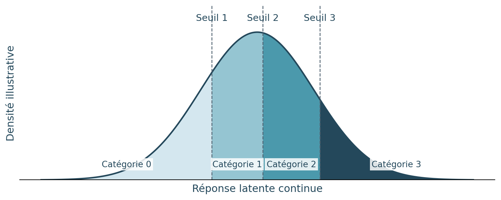
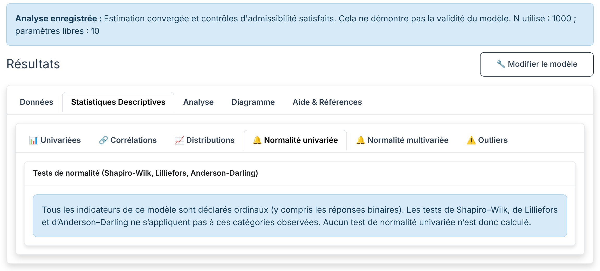
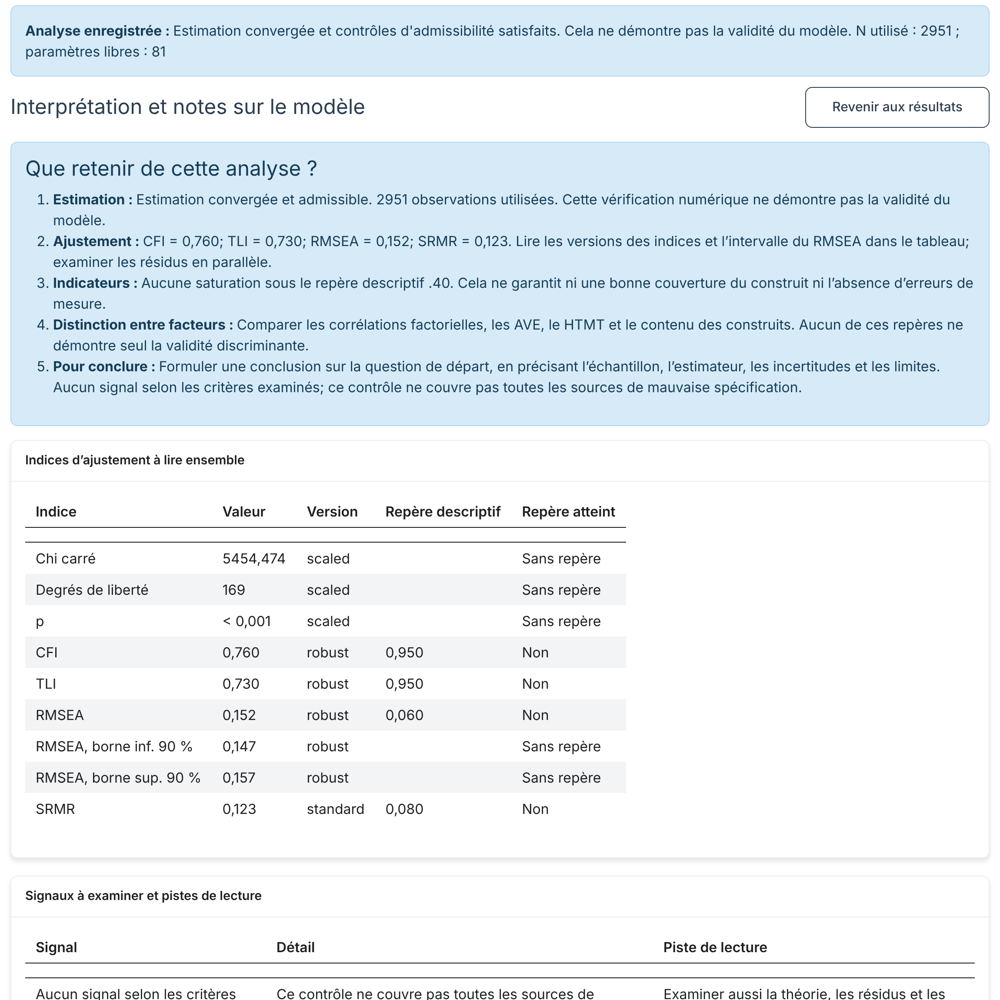

# Analyser des réponses binaires et ordinales {#sec-ordinal}

```{r}
#| include: false
source("_common.R")
L6 <- REF$lsat6; L7 <- REF$lsat7; MQ <- REF$msq_affect
vf <- function(x, ver, col) x$versions[[col]][x$versions$Version == ver]
```

::: {.callout-note title="Objectifs du chapitre"}
- Comprendre la représentation d’une réponse catégorielle par une réponse latente et des seuils.
- Déclarer des items ordinaux et choisir WLSMV.
- Lire les versions standard, *scaled* et *robust* d’un même indice.
- Situer la cible de la fiabilité dans une analyse ordinale.
:::

::: {.callout-tip title="Idée centrale"}
Un code 0, 1, 2 ou 3 n’est pas une mesure à intervalles égaux. L’AFC ordinale suppose une réponse continue cachée sous chaque item et estime les **seuils** qui la découpent en catégories. Les corrélations analysées sont alors polychoriques, et les indices portent sur ces réponses latentes.
:::

## Le nombre écrit dans la cellule ne définit pas la mesure

Une réponse correcte codée 1 et incorrecte codée 0 est une catégorie binaire. Une réponse d’intensité allant de 0 à 3 est ordonnée, mais les distances entre catégories ne sont pas automatiquement des unités égales de la propriété mesurée. Ces nombres ne doivent pas être traités comme continus simplement parce qu’ils sont stockés dans des colonnes numériques.

Dans une AFC ordinale, on représente chaque réponse catégorielle à partir d’une réponse latente continue et de **seuils**. La catégorie observée dépend de l’intervalle dans lequel se situe cette réponse sous-jacente. Ce modèle permet de distinguer la distribution des catégories et les hypothèses sur les réponses latentes.

{width=90% #fig-seuils}

Un item binaire possède un seuil; un item à quatre catégories ordonnées possède trois seuils, si toutes ces catégories sont effectivement observées et identifiables dans l’analyse. Des catégories très rares ou absentes peuvent poser des difficultés.

## Déclarer les items et choisir l’estimateur

Dans **Modèle & Spécification**, les contrôles **Items ordinaux** permettent de cocher les indicateurs concernés. Vérifiez ces déclarations pour chaque facteur. **Tout sélectionner** s’applique au groupe d’indicateurs du facteur affiché.

{#fig-app-lsat6 width=100%}

Les modèles réels binaires ou ordinaux fournis sont déjà préparés avec **WLSMV** après **Charger cet exemple et son modèle**. Dans ce contexte, l’estimation exploite des relations adaptées aux catégories, avec des erreurs-types et un test corrigés. Le libellé technique de DWLS peut aussi apparaître dans certaines sorties, car WLSMV s’appuie sur une estimation pondérée diagonale et des corrections supplémentaires [@lavaancat].

Les choix **DWLS**, **ULS** ou **WLS** sont proposés pour des usages plus spécifiques; ils ne sont pas des méthodes à départager uniquement en choisissant celle qui donne l’indice le plus favorable. Ce manuel retient WLSMV pour les activités ordinales. Lorsque des items sont déclarés ordinaux, l’application refuse d’ailleurs ML et ML robuste.

La combinaison FIML avec les indicateurs déclarés ordinaux n’est pas disponible ici. Conservez **Cas complets** dans les exercices concernés. Une analyse interrompue pour incompatibilité de réglages ne doit pas être contournée en décochant artificiellement les items ordinaux.

## Première activité avec LSAT 6

Le LSAT 6 comporte cinq réponses binaires pour `r ent(L6$n)` observations. Le modèle de départ comporte un seul facteur `Aptitude`. Les réponses sont développées à partir des effectifs des profils publiés; leur ordre ne fournit pas des identifiants individuels d’origine [@bock1970].

1. Dans **Données réelles**, sélectionnez **LSAT 6**.
2. Cliquez sur **Charger cet exemple et son modèle**.
3. Vérifiez un seul facteur et les indicateurs `Q1`, `Q2`, `Q3`, `Q4`, `Q5`.
4. Vérifiez **Items ordinaux (5/5)**, **WLSMV** et **Cas complets**.
5. Estimez, puis ouvrez **Statistiques Descriptives → Normalité univariée**.
6. Vérifiez qu’une note remplace les tests continus; il ne manque pas un tableau utile.
7. Consultez les paramètres, les seuils et **4. Interpréter**.

{#fig-app-note width=100%}

```{r}
#| label: fig-lsat6-seuils
#| fig-cap: "Seuils estimés des cinq items du LSAT 6 sur l’échelle de la réponse latente (moyenne 0, écart type 1). Plus le seuil est bas, plus l’item est facile : la proportion attendue de réponses correctes est l’aire de la courbe normale au-delà du seuil."
#| fig-height: 3.2
s <- L6$seuils; s$p <- pnorm(-s$est)
ggplot(s, aes(est, lhs)) +
  geom_vline(xintercept = 0, colour = PAL["gris"]) +
  geom_point(size = 3.4, colour = PAL["bleu"]) +
  geom_text(aes(label = paste0(v(est, 2), "  (", pct(p), " correctes)")), hjust = -.12, size = 3.3) +
  scale_x_continuous(limits = c(min(s$est) - .2, 1.2), labels = function(x) v(x, 1)) +
  labs(x = "Seuil (échelle de la réponse latente)", y = NULL) + theme_manuel()
```

Les cinq seuils sont négatifs : tous les items sont réussis par une majorité de candidats. `r s$lhs[which.min(s$est)]` est le plus facile (seuil `r v(min(s$est), 2)`), `r s$lhs[which.max(s$est)]` le plus difficile (seuil `r v(max(s$est), 2)`).

Le modèle a `r ix(L6$fit, "df", 0)` degrés de liberté. Un RMSEA nul ou un CFI de 1 dans cet exemple ne signifie pas que l’instrument est parfait. Ces résultats doivent être replacés dans le modèle, l’effectif, les degrés de liberté et l’incertitude des tests.

Reprenez ensuite **LSAT 7** avec son modèle préparé. Analysez les deux fichiers séparément : les lignes de LSAT 6 et LSAT 7 ne doivent pas être appariées comme si elles provenaient des mêmes personnes.

## Le cas MSQ

Le fichier proposé dans l’application conserve vingt adjectifs d’affect et la première occasion de mesure pour `r ent(MQ$lignes)` participants. Les réponses vont de **0 = pas du tout** à **3 = beaucoup**, à propos du moment présent. Le modèle oppose deux ensembles corrélés : `AffectPositif` et `AffectNegatif`.

Cette sélection est un sous-ensemble documenté du MSQ. Elle ne correspond pas à une nouvelle collecte indépendante de l’instrument PANAS, même si les clés d’affect renvoient à cette littérature. Les données réunissent plusieurs études et conditions; la simplicité du modèle reste une hypothèse [@watson1988].

Chargez **MSQ**, puis **Charger cet exemple et son modèle**. Vérifiez dix indicateurs par facteur, vingt déclarations ordinales, WLSMV et les cas complets. **`r ent(MQ$n)` participants** disposent de réponses complètes pour ces vingt indicateurs; `r MQ$lignes - MQ$n` lignes ne sont pas utilisées dans cette estimation par cas complets.

## Lire les versions des indices sur MSQ

Les valeurs suivantes proviennent du même modèle et des mêmes données. Elles illustrent pourquoi il faut annoncer la version lue :

```{r}
#| label: tbl-msq-versions
#| tbl-cap: !expr 'paste0("Trois versions du CFI et du RMSEA pour le même modèle MSQ (WLSMV, ", (ent(MQ$n)), " cas complets).")'
tab(MQ$versions)
```

{#fig-app-msq width=100%}

Dans **4. Interpréter**, l’application privilégie les versions robustes disponibles pour CFI et RMSEA et indique leur version. Un CFI standard de `r v(vf(MQ, "Standard", "CFI"))` ne contredit donc pas un CFI robuste de `r v(vf(MQ, "Robust", "CFI"))` dans la synthèse. Vous ne comparez pas la même correction de l’indice.

Le SRMR vaut `r v(MQ$srmr)`. La synthèse des diagnostics ne soutient pas une reproduction satisfaisante de toutes les relations par ce modèle simple. Le nombre important de répondants et des saturations souvent fortes ne font pas disparaître ces écarts.

## Fiabilité et cible de l’indice

Dans les suppléments, les omégas des deux dimensions du MSQ sont élevés (`r paste(v(MQ$val$results$Omega), collapse = " et ")`). Ils portent ici sur les réponses latentes continues. Ils ne suffisent pas à valider l’ajustement global et ne décrivent pas directement la fiabilité d’une somme des catégories observées.

Pour le facteur négatif notamment, plusieurs adjectifs très proches peuvent partager du contenu spécifique. Avant de retirer des items ou d’ajouter des covariances résiduelles, formulez ce que vous chercheriez à représenter et quel effet cela aurait sur la définition du construit.

## Laboratoire : deux sections du LSAT

Estimez LSAT 6 puis LSAT 7 avec leurs modèles préparés. Pour chacun, relevez l’effectif, les degrés de liberté, le CFI et le RMSEA **dans leurs trois versions** (sortie détaillée de **Analyse → Analyse de base → Résultats**). Quelle section le modèle à un facteur décrit-il le mieux ? Pourquoi faut-il préciser la version avant de répondre ?

::: {.callout-tip title="Réponse" collapse="true"}
```{r}
d <- rbind(cbind(Section = "LSAT 6", L6$versions), cbind(Section = "LSAT 7", L7$versions))
tab(d)
```
Les deux analyses utilisent `r ent(L6$n)` observations et `r ix(L6$fit, "df", 0)` degrés de liberté. Le modèle décrit très bien le LSAT 6 dans toutes les versions. Pour le LSAT 7, le RMSEA passe de `r v(vf(L7, "Standard", "RMSEA"))` (standard) à `r v(vf(L7, "Robust", "RMSEA"))` (robuste) : selon la version citée, on conclurait à un ajustement excellent ou seulement acceptable. Il faut donc toujours nommer la version. Les deux échantillons étant distincts, aucun test de différence entre eux n’est approprié.
:::

::: {.callout-important title="À retenir"}
- Des codes ordinaux ne sont pas des mesures à intervalles égaux : déclarez les items ordinaux et utilisez WLSMV.
- Les seuils situent les catégories sur l’échelle de la réponse latente.
- Une même analyse produit plusieurs versions d’un indice : nommez celle que vous citez.
- Oméga ordinal décrit la réponse latente, pas la somme des catégories observées.
:::

## Quiz

1. Un item à cinq catégories toutes observées possède combien de seuils ?
2. Pourquoi l’application refuse-t-elle ML lorsque des items sont déclarés ordinaux ?
3. Le CFI standard du MSQ vaut `r v(vf(MQ, "Standard", "CFI"))`. Peut-on écrire que le modèle s’ajuste bien ?
4. Pourquoi ne peut-on pas utiliser FIML avec ces items ordinaux dans l’application ?

::: {.callout-tip title="Réponses" collapse="true"}
1. Quatre.
2. ML suppose des indicateurs continus; il traiterait les codes comme des mesures à intervalles égaux.
3. Non. Les versions corrigées (CFI robuste `r v(vf(MQ, "Robust", "CFI"))`) et le SRMR (`r v(MQ$srmr)`) indiquent des écarts importants; citer seulement la version favorable serait trompeur.
4. FIML est proposé ici avec ML ou ML robuste, donc pour des indicateurs continus; l’estimation ordinale passe par les corrélations polychoriques et les cas complets.
:::
