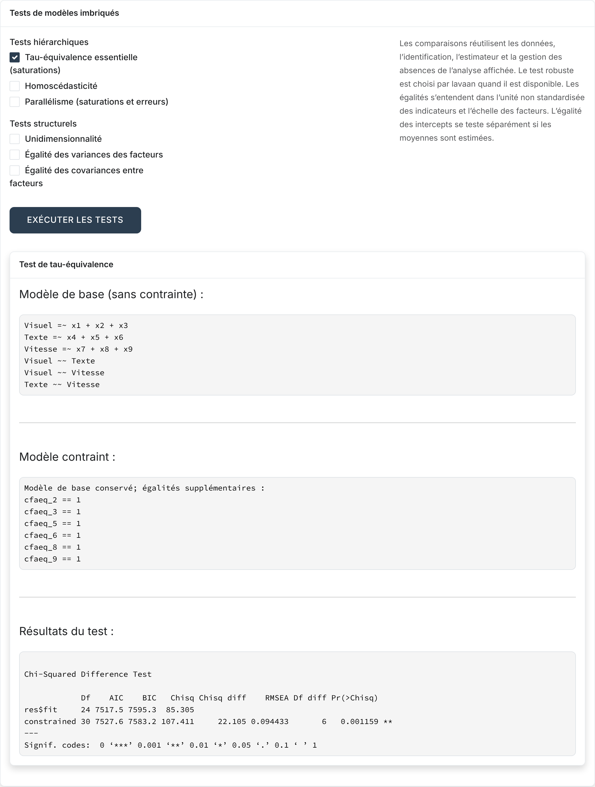
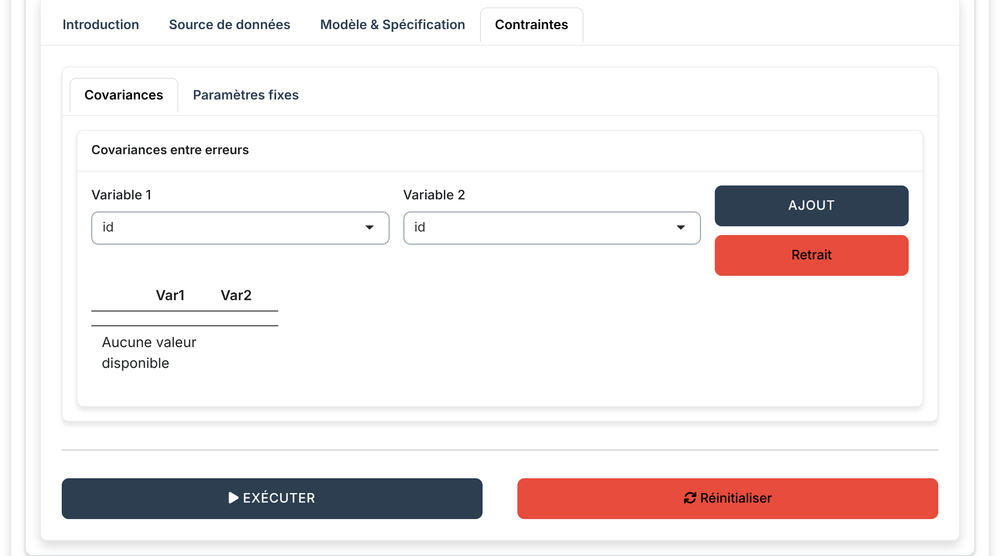

# Poser et comparer des restrictions interprétables {#sec-contraintes}

```{r}
#| include: false
source("_common.R")
T <- REF$hs_tests; tau <- T$tau
H78 <- REF$hs78; lrt78 <- H78$lrt
```

::: {.callout-note title="Objectifs du chapitre"}
- Formuler une restriction d’égalité dans les unités où elle a un sens.
- Lancer et lire un test de différence entre modèles imbriqués.
- Ajouter une covariance résiduelle justifiée et en mesurer l’effet.
- Reconnaître les restrictions que l’application refuse de tester, et pourquoi.
:::

::: {.callout-tip title="Idée centrale"}
Une restriction est une hypothèse supplémentaire. Le test de différence demande si les données tolèrent cette hypothèse; il ne dit pas si elle est intéressante. Une liberté ajoutée améliore toujours l’ajustement; c’est sa justification qui compte.
:::

## Pourquoi imposer une égalité

Un modèle peut supposer que plusieurs indicateurs ont la même saturation non standardisée ou la même variance résiduelle. Ces restrictions simplifient la mesure et rendent certaines hypothèses explicites. Elles doivent être formulées dans des unités pertinentes.

Dire que trois saturations sont égales n’est pas la même chose que dire que trois saturations entièrement standardisées sont égales. Les égalités testées par l’application concernent les paramètres **non standardisés**. La convention d’échelle et les unités des indicateurs doivent donc être comprises avant de lancer le test.

## Préparer le modèle de référence

Passez en **Options avancées**, rechargez HS et son modèle à trois facteurs. Conservez ML, les cas complets et l’indicateur de référence. Estimez ce modèle sans restriction supplémentaire. Enregistrez son rapport avant de tester une contrainte.

Dans **Analyse → Comparaisons**, les tests réutilisent les données, la méthode et les options de l’analyse affichée. Une modification non estimée dans les contrôles ne change pas le modèle de référence du test. Si vous voulez comparer à une nouvelle configuration, estimez-la d’abord.

## Les tests hiérarchiques proposés

| Choix | Restriction ajoutée au sein de chaque facteur |
|---|---|
| Tau-équivalence essentielle | Égalité des saturations |
| Homoscédasticité | Égalité des variances résiduelles des indicateurs |
| Parallélisme | Égalité des saturations et des variances résiduelles |
| Égalité des intercepts | Égalité des intercepts, si une structure des moyennes est estimée |

Le terme *homoscédasticité* désigne ici une égalité de variances résiduelles **entre indicateurs** d’un facteur. Il ne s’agit pas directement du diagnostic d’hétéroscédasticité d’une régression selon une variable explicative.

Le parallélisme testé dans ce panneau porte sur les saturations et les erreurs. L’égalité des intercepts se demande séparément lorsque les moyennes sont estimées. Il ne faut pas attribuer à un bouton des restrictions qu’il ne pose pas.

## Première comparaison avec la tau-équivalence

Cochez seulement **Tau-équivalence essentielle (saturations)**, puis cliquez sur **Exécuter les tests**. Le modèle plus contraint passe ici de `r tau$df0` à `r tau$df1` degrés de liberté. Sur les données HS de référence, la différence de chi carré est de **`r v(tau$dchi)` pour `r tau$ddf` degrés de liberté**, avec **p = `r v(tau$p, 4)`** sous ML.

{#fig-app-comparaisons width=100%}

```{r}
#| label: tbl-tests
#| tbl-cap: !expr 'paste0("Les trois tests hiérarchiques appliqués au modèle HS de référence (ML, ", (REF$hs$n), " élèves). Chaque ligne compare le modèle contraint au modèle de base à ", (tau$df0), " degrés de liberté.")'
d <- data.frame(Test = c("Tau-équivalence", "Homoscédasticité", "Parallélisme"),
                `ddl du modèle contraint` = as.integer(sapply(T, `[[`, "df1")),
                `Δχ²` = sapply(T, `[[`, "dchi"), `Δddl` = as.integer(sapply(T, `[[`, "ddf")),
                p = vp(sapply(T, `[[`, "p")), check.names = FALSE)
tab(d)
```

Ces résultats indiquent une dégradation détectable de l’ajustement lorsque l’on impose ces égalités. Ils sont cohérents avec les saturations inégales déjà observées, notamment dans le facteur visuel. La pertinence substantielle de l’égalité reste liée aux unités des tests cognitifs.

Avec l’identification par indicateur de référence, l’égalité des saturations inclut la saturation fixée à 1 : elle n’est pas oubliée dans le test. Les autres saturations doivent alors être égales à cette référence dans l’échelle retenue. Ce n’est pas une égalité arbitraire des seules saturations qui étaient libres. C’est pourquoi le test compte `r tau$ddf` degrés de liberté : deux égalités par facteur, pour trois facteurs.

## Lire une comparaison imbriquée

Deux modèles sont imbriqués lorsque le modèle plus restrictif s’obtient en ajoutant des contraintes au modèle de référence. Sous les conditions du test, on examine la perte d’ajustement relativement au nombre de restrictions ajoutées. Une petite valeur de p signale que les égalités supplémentaires ne décrivent pas aussi bien les données dans ce cadre.

Avec une méthode robuste, utilisez le test de différence calculé par l’application et sa méthode indiquée. **Ne soustrayez pas simplement deux chi carrés corrigés.** Les corrections du test de différence doivent être prises en compte.

Une absence de rejet ne prouve pas l’égalité exacte; la précision et la puissance comptent. Examinez également la taille des différences et l’intérêt de la simplification.

## Autres égalités et limites

L’application propose l’égalité des variances factorielles lorsqu’au moins deux facteurs sont présents, et l’égalité des covariances lorsqu’il existe assez de paires. Fixer déjà toutes les variances factorielles à 1 ne laisse pas une nouvelle égalité de ces variances à tester. Une restriction sans information nouvelle doit être signalée, pas transformée artificiellement en résultat.

Les comparaisons automatisées d’égalité de cette version sont réservées aux indicateurs continus. L’égalité des moyennes factorielles n’est pas proposée comme un test ordinaire dans cette AFC à un groupe où elles servent à l’identification. L’unidimensionnalité par corrélation parfaite est également un cas limite; le test usuel n’est pas appliqué automatiquement, et l’application l’explique si vous cochez **Unidimensionnalité**.

## Ajouter une covariance résiduelle

Dans la configuration avancée, **Contraintes → Covariances** permet de choisir deux variables, puis **Ajout**. L’objectif est de représenter une relation résiduelle justifiée au-delà des facteurs. Par exemple, deux tâches partageant un format de réponse pourraient conserver une spécificité de méthode commune.

{#fig-app-contraintes width=100%}

Choisissez les variables concernées, ajoutez la covariance, vérifiez la ligne apparue, puis estimez. Ce n’est qu’après cette estimation que les résultats et le rapport reflètent la modification. **Retrait** permet de retirer la covariance sélectionnée pour une analyse ultérieure.

Sur HS, ajouter `x7 ~~ x8` fait passer le chi carré de `r ix(REF$hs$fit, "chisq")` à `r ix(H78$fit, "chisq")` pour un degré de liberté de moins (différence de `r v(lrt78[2, "Chisq diff"])`, p < 0,001). Le CFI passe de `r ix(REF$hs$fit, "cfi")` à `r ix(H78$fit, "cfi")` et le RMSEA de `r ix(REF$hs$fit, "rmsea")` à `r ix(H78$fit, "rmsea")`. Le signal **Covariance résiduelle** apparaît alors dans **4. Interpréter**, avec une corrélation résiduelle de `r sub("^.*résiduelle ([-0-9,]+)\\).*$", "\\1", H78$sig$detail[H78$sig$signal == "Covariance résiduelle"])`, et la saturation de `x7` sur `Vitesse` tombe sous 0,40.

Une amélioration d’ajustement après ajout est attendue parce que le modèle dispose d’une liberté supplémentaire. Elle ne suffit pas à valider la justification. Documentez pourquoi cette relation a été examinée, si elle était prévue et comment elle modifie le sens du modèle : ici, le facteur `Vitesse` repose désormais surtout sur `x9`, et l’oméga de la somme des trois tests baisse (chapitre sur la fiabilité).

## Paramètres fixes et étiquettes

Le panneau **Paramètres fixes** permet de fixer un paramètre à une valeur ou de lui donner un nom de paramètre. Réutiliser une même étiquette peut imposer une égalité. Cette commande demande une attention accrue : une contrainte posée sur un mauvais facteur ou dans une échelle mal comprise change réellement le modèle.

Pour la première utilisation, limitez-vous à une restriction dont vous pouvez écrire le sens en français. Si vous ne pouvez pas expliquer l’égalité souhaitée avant le clic, ne l’ajoutez pas pour améliorer seulement un indice.

## Laboratoire : tau-équivalence et fiabilité

Comparez le modèle HS de référence et sa version tau-équivalente. Consignez l’hypothèse, les degrés de liberté, le test de différence, la méthode et la conclusion. Expliquez ensuite pourquoi l’obtention de meilleures valeurs de fiabilité dans un modèle contraint ne justifierait pas de retenir ce modèle si ses restrictions étaient mal soutenues.

::: {.callout-tip title="Réponse" collapse="true"}
Hypothèse : au sein de chaque facteur, les trois tests ont la même saturation non standardisée (égale à celle de l’indicateur de référence). Le modèle contraint a `r tau$df1` degrés de liberté contre `r tau$df0`; la différence de chi carré vaut `r v(tau$dchi)` pour `r tau$ddf` dl, p = `r v(tau$p, 4)` (ML, test usuel). Les données ne soutiennent pas l’égalité des saturations : les tests contribuent inégalement à leur facteur, ce que montraient déjà les saturations standardisées.

Un modèle contraint peut afficher une fiabilité différente parce que ses paramètres sont imposés, pas parce que la mesure est meilleure. Si la restriction est rejetée par les données, ses indices décrivent un modèle qui ne représente pas bien les tests : les citer reviendrait à choisir le modèle pour son résultat.
:::

::: {.callout-important title="À retenir"}
- Les égalités testées portent sur les paramètres non standardisés, dans l’échelle choisie.
- Un test de différence compare deux modèles imbriqués estimés sur les mêmes données et avec la même méthode.
- Avec un estimateur robuste, on utilise le test de différence corrigé, pas une soustraction.
- Une covariance résiduelle améliore toujours l’ajustement : sa justification doit précéder son ajout.
:::

## Quiz

1. Pourquoi la tau-équivalence ajoute-t-elle six degrés de liberté au modèle HS ?
2. Le test de tau-équivalence n’est pas significatif. Les saturations sont-elles égales ?
3. Peut-on tester l’égalité des variances factorielles avec l’identification σ²(F)=1 ?
4. Après l’ajout de `x7 ~~ x8`, le CFI s’améliore. Est-ce une preuve que la covariance existe ?

::: {.callout-tip title="Réponses" collapse="true"}
1. Chaque facteur a trois saturations; les rendre égales impose deux égalités par facteur, soit six pour trois facteurs.
2. Non. Les données ne permettent pas de rejeter l’égalité; la puissance et la taille des écarts restent à discuter.
3. Non : les variances sont déjà toutes fixées à 1, la restriction n’ajoute aucune information.
4. Non. Toute liberté ajoutée améliore l’ajustement; il faut une justification de contenu et, idéalement, une réplication.
:::
