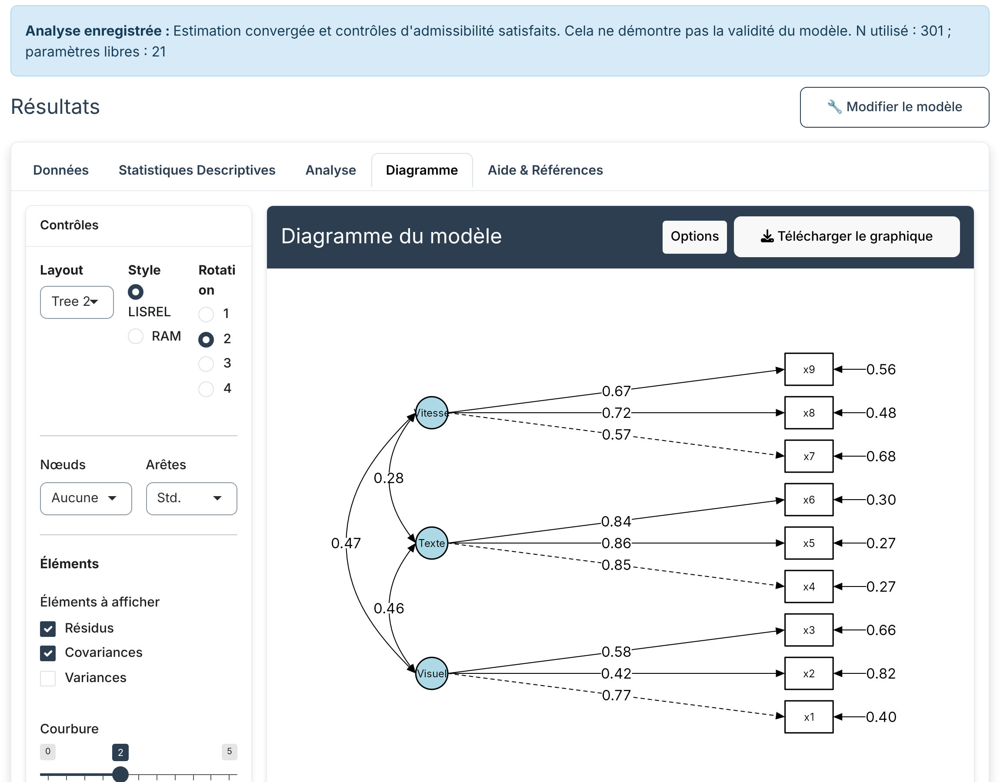
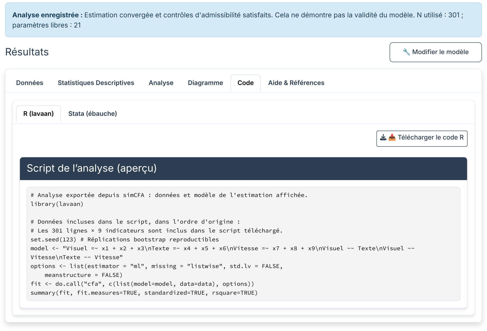

# Conserver et communiquer une analyse {#sec-rapport}

```{r}
#| include: false
source("_common.R")
SC <- REF$hs_scores; C <- REF$hs$cor
sc_r <- SC$cor[upper.tri(SC$cor)]; f_r <- C[upper.tri(C)]
```

::: {.callout-note title="Objectifs du chapitre"}
- Exporter des scores factoriels en conservant la correspondance avec les personnes.
- Comprendre pourquoi les scores ne reproduisent pas exactement les corrélations entre facteurs.
- Préparer un diagramme et un rapport qui décrivent la bonne analyse.
- Structurer une présentation écrite reproductible.
:::

::: {.callout-tip title="Idée centrale"}
Un score factoriel est une **prédiction**, pas une mesure du facteur. Un rapport n’est utile que s’il décrit exactement l’analyse enregistrée : données, modèle, estimateur, effectif et versions des indices.
:::

## Les scores factoriels sont des estimations

Dans **Analyse → Suppléments → Scores factoriels**, l’application propose **Régression** et **Bartlett**, selon la compatibilité avec le modèle et l’estimateur. Commencez avec les données continues HS et la méthode Régression.

{#fig-app-scores width=100%}

Ces scores dépendent des paramètres du modèle, de la convention d’échelle et de la méthode choisie. Deux méthodes peuvent produire des scores différents sans qu’une erreur de saisie se soit produite. Les scores factoriels ne sont pas des valeurs observées sans incertitude. Leur utilisation comme variables ordinaires dans une analyse ultérieure demande donc une réflexion sur l’erreur d’estimation qu’elle laisse de côté.

Une valeur positive ne signifie pas nécessairement « élevée » dans un sens universel. Le sens et l’échelle dépendent de l’orientation des facteurs et du modèle. Vérifiez les saturations et le codage avant d’attribuer une étiquette substantielle à un score.

## Exporter sans perdre la correspondance des personnes

Cliquez sur **Exporter** dans le panneau des scores. Le fichier contient une colonne **`ligne_source`** et des colonnes comme `score_Visuel`, `score_Texte` et `score_Vitesse`. `ligne_source` donne la position de la personne dans le fichier chargé, hors en-tête.

```{r}
#| label: tbl-scores
#| tbl-cap: "Premières lignes de l’export des scores (méthode Régression, modèle HS de référence)."
d <- SC$tete; d$ligne_source <- as.integer(d$ligne_source); tab(d)
```

Lorsque des cas ont été exclus, il ne faut pas coller la première ligne de score sur la première personne restante d’un fichier que l’on aurait réorganisé autrement. Utilisez cette colonne pour l’appariement et conservez aussi un identifiant d’origine dans votre dossier de données lorsque vous en disposez.

Avec FIML, certaines lignes peuvent avoir des scores manquants, notamment si aucune réponse utilisable ne permet une prédiction. L’application ne doit pas inventer un score pour remplir le fichier. Si une méthode de score n’est pas compatible avec l’analyse, lisez le message et revenez à une méthode appropriée; ne changez pas la nature des variables pour obtenir un export.

## Lire le nuage de scores

Pour plusieurs facteurs, le panneau de dispersion permet de comparer deux ensembles de scores. La relation observée entre ces estimations individuelles n’est pas nécessairement identique à la corrélation entre facteurs du modèle. Elle dépend aussi de la méthode de prédiction et de l’incertitude de mesure.

```{r}
#| label: tbl-scores-cor
#| tbl-cap: "Corrélations entre scores factoriels exportés (Régression) et corrélations entre facteurs du modèle."
tab(data.frame(Paire = c("Visuel – Texte", "Visuel – Vitesse", "Texte – Vitesse"),
               `Entre scores` = sc_r, `Entre facteurs` = f_r, check.names = FALSE))
```

Sur HS, les deux colonnes ne coïncident pas. Les scores de régression « tirent » chaque personne vers la moyenne en proportion de l’incertitude de sa mesure, et un score dépend aussi des indicateurs des autres facteurs. Les corrélations entre scores ne sont donc pas un substitut aux corrélations entre facteurs estimées par le modèle.

Une forme inhabituelle du nuage peut inviter à examiner les observations ou les prédictions. Elle ne constitue pas à elle seule la preuve d’une sous-population ou d’un mécanisme causal.

## Préparer un diagramme utile

Dans **Diagramme**, commencez par une disposition lisible, des noms complets et des coefficients standardisés lorsque votre objectif est de comparer la force des relations. Les options de forme, de couleur et de taille changent la représentation, pas les paramètres estimés.

{#fig-app-diagramme width=100%}

Précisez dans la légende si les nombres sont standardisés ou non. Une flèche à double sens entre facteurs représente une association; elle ne désigne pas automatiquement une influence causale réciproque. Les résidus doivent rester identifiables si leur rôle est discuté.

Le diagramme conceptuel de la configuration décrit la structure avant estimation. Le diagramme des résultats représente l’analyse enregistrée. Cette différence doit rester explicite lorsque vous incorporez une figure à un travail.

## Télécharger le rapport

Dans **Analyse → Analyse de base**, **Télécharger le rapport** génère un document HTML de l’analyse estimée. Il reprend notamment les informations de méthode, les paramètres, les indices, les avertissements et les compléments effectivement calculés. Il ne remplace pas la rédaction d’une interprétation argumentée.

Si vous avez demandé les intervalles HTMT compatibles, vérifiez qu’ils figurent dans le rapport téléchargé. Enregistrez un document distinct pour chaque modèle important. Un nom tel que `MSQ_WLSMV_2facteurs.html` est plus informatif que plusieurs fichiers appelés simplement `rapport.html`.

Les changements non estimés portant sur le modèle, les données ou la méthode ne remplacent pas l’analyse enregistrée dont provient le rapport. Le bandeau de configuration modifiée rappelle cette distinction. Les options de présentation peuvent changer les éléments affichés. Pour produire un rapport d’un nouveau modèle, estimez-le d’abord.

## Une trame de rédaction

Une présentation reproductible peut tenir en six paragraphes, dont la longueur dépend de l’enjeu :

1. **Question et contexte.** Décrire les construits, l’échantillon et la justification du modèle.
2. **Variables.** Nommer les indicateurs, leurs catégories ou unités et les recodages réellement effectués.
3. **Méthode.** Préciser l’estimateur, l’identification, les absences et l’effectif utilisé.
4. **Résultats.** Présenter les paramètres substantiels, les indices avec leurs versions et les diagnostics importants.
5. **Qualité de mesure.** Discuter la fiabilité, la distinction des facteurs et les limites des indices.
6. **Conclusion.** Répondre à la question et indiquer ce qui reste incertain ou demanderait une autre étude.

Ne remplacez pas ces paragraphes par un empilement de tableaux. Un lecteur doit pouvoir comprendre pourquoi le modèle a été estimé et ce qui découle des résultats.

## Le code reste facultatif

Le mode avancé donne accès, dans l’onglet **Code**, au code R exportable et à une ébauche Stata. Le script R contient les données analysées, le modèle et les options de l’estimation affichée : il reproduit exactement l’analyse dans R. Ces éléments peuvent servir à un audit ou à une reprise de l’analyse par une personne compétente. Ils ne sont pas nécessaires pour réaliser les activités du manuel. L’ébauche Stata ne garantit pas une équivalence de calcul avec le moteur utilisé dans l’application.

{#fig-app-code width=100%}

## Laboratoire : une page autonome

À partir de votre rapport HS, rédigez une page autonome comprenant une petite figure et un tableau de paramètres choisis. Une personne qui ne voit pas votre session doit pouvoir identifier les données, le modèle, l’estimateur et les limites de votre conclusion. Vérifiez que chaque nombre cité correspond au même modèle enregistré.

::: {.callout-tip title="Réponse" collapse="true"}
Une page satisfaisante contient au minimum : le nom du fichier et l’effectif utilisé (`r REF$hs$n` élèves); la structure (trois facteurs corrélés, trois tests chacun, aucune covariance résiduelle); la méthode (ML, λ₁=1, cas complets); les indices avec leur version (χ² = `r ix(REF$hs$fit, "chisq")`, `r ix(REF$hs$fit, "df", 0)` dl; CFI `r ix(REF$hs$fit, "cfi")`; RMSEA `r ix(REF$hs$fit, "rmsea")` [`r ix(REF$hs$fit, "rmsea.ci.lower")`; `r ix(REF$hs$fit, "rmsea.ci.upper")`]; SRMR `r ix(REF$hs$fit, "srmr")`, versions standard); le diagramme avec une légende qui précise « coefficients standardisés »; une phrase sur la fiabilité modeste du facteur visuel; une conclusion qui mentionne les écarts d’ajustement. Le contrôle final consiste à vérifier que tous ces nombres viennent du même rapport.
:::

::: {.callout-important title="À retenir"}
- Un score factoriel est une prédiction qui dépend du modèle et de la méthode.
- `ligne_source` garantit l’appariement des scores aux personnes du fichier.
- Les corrélations entre scores ne remplacent pas les corrélations entre facteurs.
- Un rapport décrit l’analyse enregistrée : estimez avant de télécharger.
:::

## Quiz

1. Pourquoi ne pas coller les scores exportés à côté du fichier d’origine sans regarder `ligne_source` ?
2. Les scores Régression et Bartlett diffèrent. Lequel est le « vrai » score ?
3. Une flèche à double sens relie deux facteurs dans le diagramme. Que représente-t-elle ?
4. Le script R de l’onglet **Code** est-il nécessaire pour réaliser les activités ?

::: {.callout-tip title="Réponses" collapse="true"}
1. Si des cas ont été exclus, les lignes ne se correspondent plus une à une; `ligne_source` donne la position exacte de chaque personne.
2. Aucun : ce sont deux méthodes de prédiction aux propriétés différentes.
3. Une covariance (ou corrélation) entre facteurs, sans direction causale.
4. Non. Il sert à l’audit ou à la reprise de l’analyse dans R.
:::
